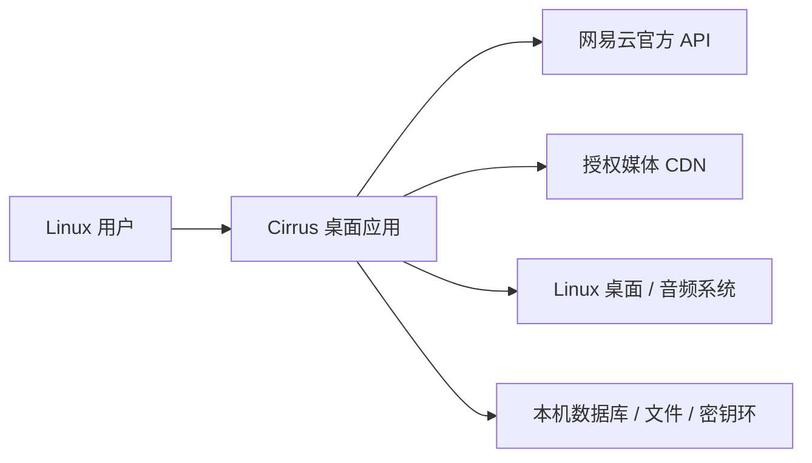

# 00 · 项目现状与文档约定

> 基线 0.1 · 2026-09-26 · 状态：提案。本文记录本次检查到的事实，未来应随代码更新。

## 1. 目标与已知输入

产品名称 **Cirrus**，工程和仓库名称 **CirrusMusic**。目标是填补 Linux 上网易云音乐桌面客户端的使用空白，尽可能覆盖其**歌曲相关**能力，而不是复制整个内容社区或商业生态。

已知约束：

1. 采用 Qt Quick/QML，C++ 承担客户端业务和基础设施。
2. 维护者已拥有网易云官方 API 接口资料。Cirrus 直接调用官方 API，端点与协议适配内置于客户端，用户无需配置 API、部署服务或安装代理。具体规范、样例和版本尚未放入此仓库。
3. 不使用 Qt 默认控件外观作为成品设计；构建自有控件体系。
4. 全屏／沉浸播放页以 Apple Music 的信息层级、封面与歌词体验为参考。当前阶段只制定 UI 工程规范，不制作视觉稿，不复制 Apple 商标和素材。
5. 首要平台为 Linux 桌面；Windows/macOS 可保留编译边界，不列入首版验收。

## 2. 当前代码审计

| 文件／配置 | 已观察事实 | 对实施的影响 |
| --- | --- | --- |
| `CMakeLists.txt` | CMake 最低 3.16；`project(CirrusMusic VERSION 0.1)`；仅查找 `Qt6::Quick` | CMakeLists 尚未显式设置 C++ 标准；当前开发 presets 设置 C++20。Network、Multimedia、Sql 等业务模块未接入 |
| Qt 工程初始化 | `qt_standard_project_setup(REQUIRES 6.10)` | 模板以 6.10 为最低 Qt 设置要求，不证明各平台兼容性 |
| `main.cpp` | 创建 `QGuiApplication`、`QQmlApplicationEngine`；从 `CirrusMusic/Main` 加载 | 可作为 composition root 起点，目前没有依赖注入和服务生命周期管理 |
| `Main.qml` | 640×480 示例窗口、Hello World、明暗切换；导入 Basic 控件 | 不是产品 UI，后续替换而非逐层堆叠业务 |
| QML 模块 | URI 为 `CirrusMusic`，挂在 `appCirrusMusic` target | 初期保留作为根模块，拆出 `Cirrus.Controls` 等独立模块 |
| `importedcontent/` | Figma-to-Qt 占位说明 | 不是正式设计源；若不使用设计导入工作流可在实施期移除 |
| 构建配置 | Qt Creator 缓存及 VS Code 的 Debug/Release 私有 presets 使用本机 Qt 6.11.2 | 共享 presets 不含个人路径；私有 CMakeUserPresets.json 和构建产物不入库 |
| 测试与发布 | 无测试、CI、数据库、播放器、API 客户端及安装包 | 后文所有这些能力均为待实施 |
| Git | 最初审计时无提交，模板为 intent-to-add；维护者随后要求将模板、文档与 VS Code 配置纳入首个提交 | 不包含 Qt Creator 私有配置、个人 Qt 路径或构建产物 |

音乐客户端功能仍未实施。后续 VS Code 配置阶段已验证模板 Debug/Release 构建、QML lint、clangd、GDB 断点和 offscreen 冒烟；具体环境与验证边界见[17](17-vscode-development.md)，不等于通过产品功能测试。

## 3. 术语

| 术语 | 本项目含义 |
| --- | --- |
| 客户端后端 | 运行在 Cirrus 进程中的 C++ 业务、网络、存储、音频调度代码；不是另造网易云服务端 |
| 官方 API／Provider | 网易云官方服务接口；由客户端内置适配器直接访问，不经过用户配置的第三方服务 |
| 适配器／Gateway | 将实际接口 DTO 映射到 Cirrus 领域模型的 C++ 实现 |
| 领域模型 | 不依赖接口 JSON 和 QML 页面的稳定业务概念 |
| Track | 歌曲元数据实体，不等同于音频文件、URL 或队列中的一次出现 |
| PlayableSource | 本次合法可播放的来源，包含短期地址或本地文件授权信息 |
| QueueEntry | 队列中一次歌曲出现，有独立 ID；同一歌曲允许多次出现 |
| entitlement／权限 | 账号、地区、版权、音质、下载授权等决定的能力，不能仅以“VIP=true”推导 |
| 缓存 | 可重新生成、可被自动淘汰的数据，不代表永久离线授权 |
| 下载／离线资源 | 明确用户意图并受授权约束保存的资源，不能当作普通缓存自动删除 |
| sessionEpoch | 登录、登出、换号或会话失效时递增的会话代数，用于丢弃旧响应 |
| playbackGeneration | 每次播放目标或媒体实例失效时递增的播放代数，用于防止串歌 |
| capability | 经契约确认／运行时探测的能力，而不是 UI 根据按钮有无猜测出的能力 |

## 4. 边界图

此拓扑已由维护者明确：桌面客户端直接连接官方服务。C++ 后端包含接口要求的请求构造、签名／加密、会话管理及 DTO 转换。不引入独立业务服务器、Node.js 常驻进程或用户可编辑的 API 地址设置。测试替身只通过测试构建的依赖注入接入。

## 5. 假设与确认规则

- **A-01**：API 至少能够提供歌曲查询、元数据和授权播放来源。M0 验证；否则在线播放主路径被阻塞。
- **A-02**：官方协议要求的签名／加密流程可在 C++ 内实现或通过经过审查的本地库实现。M0 依据维护者提供的资料验证；不凭猜测编造算法与密钥。
- **A-03**：首版目标架构为 x86_64，优先 GNOME/KDE、Wayland，兼顾 X11。维护者可调整，但要重新估算测试矩阵。
- **A-04**：不要求首版实现专业 DSP、位完美输出或保证无缝衔接。若这些是硬性要求，应在选择播放器之前修改需求。
- **A-05**：账号登录优先使用接口实际支持的扫码方式；验证码、密码或 Web 登录只有在契约明确后加入。

假设不是事实。每条假设的证据写入 M0 记录；无法验证时进入[问题清单](15-risks-and-open-questions.md)，使用 mock 继续不受影响的模块，不能伪造真实服务成功。
