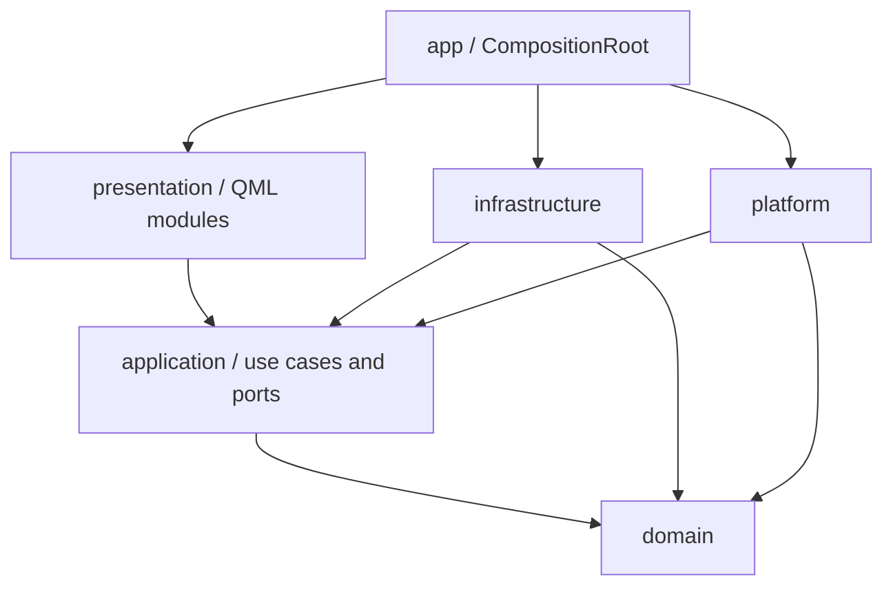
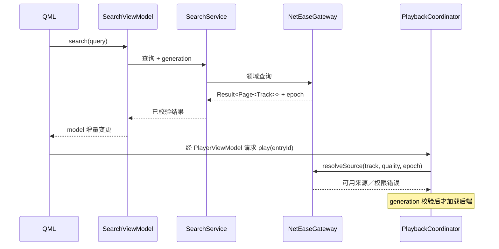

# 03 · 系统架构与模块契约

> 状态：提案 · 关联：ADR-0002、ADR-0003。采用模块化单体 + 单向数据流 + 精简 MVVM／Presentation Model，不追求框架化。

## 1. 架构原则

1. 一个桌面进程直接访问网易云官方 API；不增加自建业务服务。
2. UI 发出用户意图，应用服务编排业务，领域对象维护不变量，基础设施执行副作用。
3. QML 不访问 HTTP、SQLite、Cookie、签名算法或本地任意路径；页面不直接控制 `QMediaPlayer`。
4. 播放、账号、队列有唯一权威状态；迷你栏、沉浸页、系统媒体控件只是投影。
5. 对可变外部依赖建立小接口：网络、音频、数据库、密钥环、时钟。不要为每个值类型创造抽象工厂。
6. 不把整个应用塞进 `AppManager`；也不为初期三五个功能构造微服务或 CQRS 框架。

## 2. 分层与编译依赖



箭头表示**编译依赖**，不是运行时请求方向。应用层通过其声明的 port 调用基础设施实现，由根对象注入，故不需要反向 include。

| 模块／建议 target | 内容 | 允许依赖 | 禁止 |
| --- | --- | --- | --- |
| `cirrus_domain` | ID、Track、Queue、权限、纯状态规则 | Qt Core 的值类型、C++ 标准库 | QML、Network、Sql、Multimedia、Widgets |
| `cirrus_application` | 用例、协调器、port、状态快照 | domain、Qt Core | 具体 Gateway、SQL、QMediaPlayer |
| `cirrus_infrastructure` | 官方 API、签名、SQLite、下载、Qt 播放后端 | application、domain、必要 Qt 模块和加密库 | presentation、页面对象 |
| `cirrus_platform` | 密钥环、MPRIS、portal、托盘适配器 | application、domain、Qt DBus 等 | 通过 UI 模拟点击来执行业务 |
| `cirrus_presentation` | QObject ViewModel、ListModel、UI 错误映射 | application、domain、Qml/Quick | SQL 查询、真实 URL／Cookie、协议 DTO |
| QML `Cirrus.Controls` | Tokens、自有控件、Gallery | QtQuick/Templates/Basic/Layout | 业务服务、API、播放器 |
| QML `Cirrus.Components` | TrackRow、封面、歌词视图等展示组合 | Controls、明确的展示类型 | 自行拉取官方接口 |
| `appCirrusMusic` | 启动、装配、根 QML 模块 `CirrusMusic` | 上述模块 | 业务规则集中在 main.cpp |

Domain 可以使用 `QString`、`QDateTime` 等 Qt Core 值类型，不追求完全脱 Qt；但不以 QObject 信号和数据库对象表达歌曲实体。测试 port 允许使用 QObject 协调器，不能让领域状态依赖 UI 事件循环顺序。

## 3. 建议目录

```text
src/
  app/                 # main、CompositionRoot、启动和退出
  domain/
    catalog/           # Track、Album、Artist、Playlist
    playback/          # Queue、播放策略、权限
    account/           # AccountId、会话状态值
  application/
    ports/             # IAuthGateway、ICatalogGateway、IPlaybackBackend 等
    playback/          # PlaybackCoordinator、QueueService
    library/           # LibraryService、同步编排
    account/           # SessionCoordinator
    discovery/         # SearchService、DiscoveryService
  infrastructure/
    netease/           # endpoint registry、DTO、mapper、protocol signer
    network/           # HTTP transport、重试、限流、域名策略
    audio/             # QtPlaybackBackend
    persistence/       # SQLite repositories、migrations
    files/             # 下载、扫描、缓存
  platform/linux/      # DBus、portal、托盘
  presentation/        # ViewModels、QAbstractListModel、QML 注册
qml/
  Cirrus/Controls/
  Cirrus/Components/
  CirrusMusic/          # Main、AppShell、pages、navigation
resources/             # 许可明确的图标、默认封面、翻译
tests/                 # unit、contract、integration、qml、fixtures
tools/                 # 开发与质量工具
packaging/             # Flatpak、AppImage、桌面元数据
```

以上是目标结构。已按需建立 domain/account、application/account，以及 infrastructure/netease 下的 protocol、network、session；应用层仅依赖领域值类型和 Qt Core，基础设施不反向控制应用协调器。具体已实现边界见[会话隔离说明](api/session-isolation.md)。根窗口仍是 Qt 模板，composition root／登录网关尚未装配；不为未开发功能创建大量空类。

## 4. 核心服务及契约

| 服务 | 命令／查询 | 输出与不变量 |
| --- | --- | --- |
| SessionCoordinator | 登录、取消、登出、切号 | SessionSnapshot；身份变化递增 epoch，私有请求只能归属一个 epoch |
| Catalog/SearchService | 搜索、详情、分页、取消 | `Page<T>`；查询 key、cursor、generation 对齐，不以空列表表示错误 |
| LibraryService | 喜欢、收藏、编辑歌单 | MutationReceipt；同一远程实体串行写，未知结果进入对账 |
| PlaybackCoordinator | playEntry、pause、seek、next、setQuality | PlaybackSnapshot；唯一发起音频加载和切歌的协调器 |
| QueueService | 插入、删除、排序、替换、恢复 | QueueSnapshot + revision；entryId 而非歌曲 ID 定位当前项 |
| LyricsService | 读取、解析、偏移、当前位置索引 | LyricDocument；解析与显示分开，时间线可降级 |
| DownloadService | 创建、暂停、取消、恢复任务 | DownloadSnapshot；下载任务不冒充播放缓存 |
| SettingsService | 读取／修改非敏感偏好 | 校验后的 SettingsSnapshot；不暴露凭据 |

Port 接口应该小而按能力划分：`IAuthGateway`、`ICatalogGateway`、`ILibraryGateway`、`IStreamResolver`、`ILyricsGateway`、`IPlaybackBackend`、`ICredentialStore`、`ILibraryRepository`。同一个 `NetEaseGateway` 可实现多个 port；这不是要求实现多个网络客户端。

### 4.1 异步契约

约定所有外部操作返回 `RequestId`，完成时携带：`requestId + sessionEpoch + operationKey + Result<T, AppError>`。可取消操作提供 `cancel(requestId)`；取消与完成竞争时，调用方仍必须验证 token。

- `Result<T, AppError>` 使用项目内简洁值类型或 `std::variant`，不使用 C++23 的 `std::expected` 冒充 C++20 标准库能力。
- 不为每个请求创建永久驻留 QObject；任务完成立即回收。
- 对取消也完成内部资源清理，但不显示“请求失败”toast。
- 业务错误是值，不靠跨 Qt 回调抛异常传递。
- UI 层只获得脱敏错误类别和可执行动作，不获得 HTTP 原始正文。

## 5. 线程与所有权

| 执行域 | 对象 | 规则 |
| --- | --- | --- |
| GUI 主线程 | QML、全部 ViewModel/ListModel、应用协调器、QMediaPlayer/QAudioOutput 外层对象 | 不做阻塞 I/O；`beginInsertRows` 等只能在 model 所属线程调用 |
| 网络 QThread | HttpWorker、QNetworkAccessManager、CookieJar、QNetworkReply | 在该线程初始化、使用和销毁；同一管理器不跨线程调用；账号切换清理旧 jar |
| 数据库 QThread | DatabaseWorker、SQLite 连接与 QSqlQuery | 单写者；连接在 worker 线程创建；不跨线程传 QSqlDatabase/QSqlQuery |
| 有界任务池 | 歌词解析、标签读取、哈希、批量文件扫描、图片 CPU 处理 | 输入／输出为值，分块、可取消；不操作 UI 和网络／SQL 活对象 |
| Qt 内部媒体／渲染线程 | 解码、设备、scene graph | 由 Qt 管理；不得从外部修改场景图或假定它们与 GUI 同线程 |

网络线程也不能同步执行长时间密码学／解析任务。普通小请求可内联；大型响应移交有界任务池，完成后按 token 投递。跨线程使用 queued connection 或显式调度；禁止为了“等结果”在 GUI 建嵌套 `QEventLoop`，禁止 `BlockingQueuedConnection` 形成循环等待。

QObject 使用父子所有权；普通业务对象使用明确的值／`unique_ptr` 所有权，不同时交给 QObject parent 和智能指针重复释放。回调绑定 context 对象，必要时用 `QPointer`；generation 检查不能替代对象存活检查。

## 6. QML 边界

- 使用 `qt_add_qml_module`、`QML_ELEMENT` 等声明式注册生成类型信息；不堆叠无类型 `setContextProperty` 全局对象。
- 装配根创建有状态 ViewModel，作为明确类型的根属性／受控服务入口注入；不要让每个页面 new 一个播放器。
- `Q_PROPERTY` 有清晰读写权限和 NOTIFY；用户命令用窄 `Q_INVOKABLE`，不能开放任意 operation 字符串调用官方 API。
- 大列表为 `QAbstractListModel`，角色稳定且有类型说明；不要从 C++ 不断复制整份 `QVariantList`。
- 页面临时状态（悬停、展开、输入中）留在 QML；查询状态、会话、下载和播放留在 ViewModel/应用层。
- 页面销毁只取消页面所有的查询，不应停止全局播放或退出账号。

## 7. 请求流程例：搜索并播放



## 8. 生命周期

启动：初始化应用身份和日志 → 校验单实例 → 读取非敏感设置 → 打开／迁移 DB → 创建服务与 worker → 创建 QML → 异步恢复账号和缓存。首页可交互不等待官方接口；恢复失败保持游客状态并说明原因。

退出：拒收新任务 → 停止播放并保存快照 → 取消网络／下载 → 刷新事务 → 关闭线程内连接 → 正常退出 worker → 释放服务。设定整体退出预算（初值 3 s），超时记录脱敏诊断，不以强制线程终止代替资源管理。

登录／切号：先冻结账号写操作并递增 epoch → 取消旧任务 → 停止账号来源播放并清理授权 URL → 切换数据库命名空间与 CookieJar → 加载新账号。通用公开元数据可保留，但私人歌单、云盘、历史、评论草稿不混用。

## 9. 可演进性与约束验证

测试以 fake port 驱动应用服务；生产只有装配层知道具体实现。CI 检查 target 依赖、禁止 include 列表及 QML 中的 HTTP/SQL 使用。允许为明确需求替换播放器或升级协议适配器，但不提前设计运行时插件 ABI。架构例外在 PR 中登记，到下个里程碑复查。
