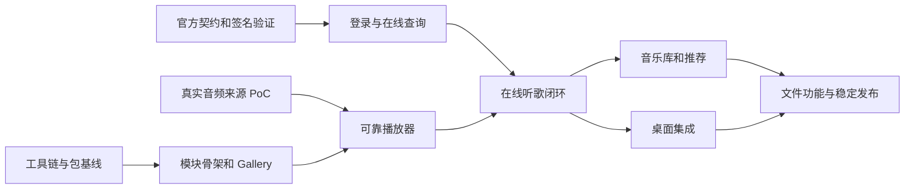

# 14 · 实施路线与任务拆解

> 状态：提案。按依赖和验收推进，而不是按页面数量推进。当前已完成技术文档和 VS Code 基础配置；B-005 的开发 presets 部分已落地，分层架构、CI、测试套件及业务功能仍未实施。见[当前开发环境](17-vscode-development.md)。

## 1. 阶段总览

| 阶段 | 交付物 | 进入条件 | 退出门禁 | 参考有效人周 |
| --- | --- | --- | --- | --- |
| M0 可行性与契约冻结 | 官方 API 契约样本、签名 PoC、真实音频 PoC、平台／工具链矩阵 | 维护者提供核心接口资料 | P0 官方直连可行、播放器／打包路线可验证；关键未知项有决定 | 1–2 |
| M1 工程与控件基础 | 模块骨架、CI、fake ports、DB 迁移、Gallery、本地样本播放 | M0 核心技术不再悬而未决 | 干净构建、测试、键盘基础、本地播放及退出无泄漏 | 2–4 |
| M2 在线听歌闭环 | 登录、搜索、详情、播放、音质、队列、逐行歌词、迷你／沉浸页 | 官方核心 operations 完成映射 | FR-001～004/006/008/010/017～023/040 对应 P0 通过，可内部 alpha | 4–6 |
| M3 音乐库与桌面体验 | 喜欢、歌单编辑、收藏、推荐/FM、历史、逐字歌词、MPRIS | M2 长时间播放稳定 | 完整日常听歌路径；账号隔离／写对账／Linux 控制通过 | 4–6 |
| M4 文件与稳定发布 | 下载、离线、本地库、云盘浏览、评论读取／点赞、设置、发布包 | 主流程与接口错误处理稳定 | 全部 P0 + 目标 P1、迁移、8 h、双 Wayland 桌面、许可／安全门禁 | 5–9 |
| M5 完整度与高级能力 | 云盘写、评论写、MV、桌面歌词、导入导出、高级音频 | 稳定版反馈和后端能力已明确 | 每项独立设计／验收，不以一张“大完成”清单带过 | 另估 |

参考成本合计 M0～M4 为 **16–27 有效人周**，是假设接口资料完整、全职熟悉 Qt 的单人／小团队估算，不是日期承诺；需求变更、视觉迭代、接口变化和打包问题会改变成本。多人不能简单按人数除，因为播放器、契约、UI 与测试存在串行依赖。

M2 的 FR-022 是逐字增强，不计入该阶段 P0 门禁；M3 才目标验收。表中范围包含条目不意味着所有其子能力均在同阶段完成，以 01 的逐行优先级为准。

## 2. 关键依赖链

允许父级直接推进互不阻塞的工作，例如在等待接口资料时实现 Gallery、队列单测与本地音频 PoC；不把真实 API gate 假装通过。图表示技术依赖，不授权自动委派或启动并行代理。

## 3. 可转 issue 的工作包

下表是 epic／工作包，不要求一个 PR 完成。实施时再拆成约 1–3 日、可独立验收的小任务。

| ID | 工作包及产物 | 前置 | 对应需求／退出证据 |
| --- | --- | --- | --- |
| B-001 | 建立官方 operation registry、资料目录及脱敏 fixture | 接口交接 | FR-001；至少 auth/search/details/stream/lyrics 有真实契约 |
| B-002 | 协议编码／签名 PoC 与固定测试向量 | B-001 | TC-API；不使用用户端点设置／第三方代理 |
| B-003 | Qt 音频与官方流 PoC；比较备选后端 | B-001 | FR-017/018；真实 seek、过期、headers、格式证据 |
| B-004 | 冻结 Qt/编译器、app ID、发行 Runtime 与许可候选 | 无 | ADR-0001/0007；最小包在目标桌面启动 |
| B-005 | 分层 CMake、presets、CI、测试入口、日志 | B-004 | NFR-011/012；干净 checkout 可重建且 CTest 有测试 |
| B-006 | Domain IDs、Track/Page/Queue、错误模型、fake ports | B-005 | FR-008/019/020；性质测试、超大 ID 不丢精度 |
| B-007 | Tokens、基础 Controls、Gallery、键盘焦点和主题 | B-005 | FR-037；QML 测试、Orca 基础检查 |
| B-008 | SQLite worker、profile 隔离、首个 migration、设置 | B-005/006 | NFR-007/008；事务／中断恢复测试 |
| B-009 | 网络 worker、端点策略、超时取消、重试和脱敏 | B-002/005 | FR-001/040；TC-API/SECURITY |
| B-010 | SessionCoordinator、密钥环、扫码／恢复／退出 | B-008/009 | FR-002～005；换号晚到回包不污染 |
| B-011 | 搜索、目录与详情 ViewModels/ListModels | B-006/009/010 | FR-006～010；分页与 IME 测试 |
| B-012 | PlaybackCoordinator、后端、队列与 generation | B-003/006/008 | FR-017～020；千次切歌及旧事件测试 |
| B-013 | 歌词解析／同步、逐行／翻译／逐字降级 | B-001/012 | FR-021/022；解析 fixture、seek 后时钟测试 |
| B-014 | AppShell、路由、歌曲列表、迷你栏和沉浸页 | B-007/011/012/013 | FR-023/037/040；真实交互和性能证据 |
| B-015 | 喜欢、收藏、歌单编辑和写对账 | B-010/011/008 | FR-011～014；部分成功与未知写结果测试 |
| B-016 | 推荐、每日、榜单、FM 与历史 | B-012/015 | FR-015/016/024；离线缓存、FM 耗尽与实际收听量 |
| B-017 | MPRIS、通知、可选托盘、快捷键、单实例 | B-004/012/014 | FR-033～035；GNOME/KDE Wayland 真机证据 |
| B-018 | 下载服务、Range／hash、离线索引、空间管理 | B-008/009/010 | FR-025/026；崩溃窗口与授权回归 |
| B-019 | 文件 portal、增量扫描、标签、去重和重定位 | B-008/017 | FR-027；坏文件／撤销授权／符号链接测试 |
| B-020 | 云盘列表／播放、评论读取／点赞 | B-010/011/012 | FR-028/030；私有缓存与安全文本测试 |
| B-021 | 完整设置、休眠／设备／断网恢复、国际化 | B-014/017/018 | FR-038/039；主要恢复路径与缩放矩阵 |
| B-022 | Flatpak 正式包、AppImage 验证、发布元数据与文档 | B-004/017/021 | TC-PACKAGE；最小权限、SBOM、安装／升级 |
| B-023 | 稳定性、性能、无障碍、安全和真实协议总回归 | B-015～022 | 全部 P0、目标 P1、NFR；无 S0/S1 |
| B-024 | 云盘上传管理与评论发布 | M4；对应契约 | FR-029/031；逐操作审查写恢复与审核态 |
| B-025 | MV 与播放焦点 | M4；媒体 PoC | FR-032；视频独立部署／回归 |
| B-026 | 桌面歌词、导入导出、睡眠定时器和高级音频 | M4；专项 ADR | FR-036/041/042；每个子能力单独 capability 和证据 |

## 4. 第一轮实际动手顺序

1. 维护者交付核心官方接口资料，完成[交接表](checklists/api-handoff.md)。不需要给终端用户提供任何 API 配置流程。
2. 用最小程序验证签名及真实歌曲来源；保存去敏验证记录，而不是先做完整首页。
3. 在目标发行环境做 Qt 音频小 PoC，判断是否继续默认后端。
4. 确认 app ID、许可候选、Qt/Runtime 与最低环境，采纳对应 ADR。
5. 建立 tests、presets 和分层 targets，让应用持续可启动。
6. 写 Queue/Track/Error 的值模型与 fake gateway，先验证不变量。
7. 实现 DB worker 和 sessionEpoch 协议。
8. 做 Gallery 的 Button/TextField/Slider、主题和键盘焦点。
9. 实现本地音频 PlaybackCoordinator，跑 race 用例。
10. 接入官方登录、搜索、详情与 stream.resolve。
11. 接入规范化歌词与共用 PlayerViewModel。
12. 完成一条“启动→搜索→播放→喜欢→退出→恢复”的垂直切片，再扩展全部页面。

“喜欢”完整验收在 M3，第一轮可先做最小受控版本验证写链路；不得因此跳过后续冲突／对账测试。

## 5. 定义：准备好开发与真正完成

**Definition of Ready**：需求 ID 和范围清楚；UI 状态／业务输入输出明确；API 契约或 fake 边界明确；依赖可用；验收可重复；权限和数据影响已评估。

**Definition of Done**：代码、测试、失败与取消、线程与内存、无障碍、文档和迁移均完成；真实依赖功能有相应实测证据；无新严重缺陷；能在发布配置运行。不存在“接口回来了但 UI 以后再处理错误”的完成状态。

## 6. 范围控制与停止条件

- M0 若官方来源无法由当前播放器安全稳定处理，停止该后端的功能堆叠，先改 ADR。
- 写操作没有明确确认／重试语义时，暂不向用户开放该操作；只读界面可继续。
- UI 可在 fake 数据上迭代，但发布门禁不可由 mock 代替。
- 所有 P0 是稳定版硬条件；P1 降级需明确原因、影响用户、替代方案、恢复计划和维护者批准。
- P2 不挤占稳定性时间。任何“顺便做插件系统／自建云同步”都需新需求，而不是默认扩大工程。
- 官方接口变动优先修复适配器和契约测试，避免在页面内加临时判断补丁。

## 7. 阶段评审记录

每阶段结束记录：版本／提交、完成 FR、未完成与降级、测试报告、性能样本、真实接口验证日期、风险变化、依赖清单、下阶段计划。负责人角色至少包含维护者、实现者和验证者；小项目可同人承担，但事实证据不能省略。
