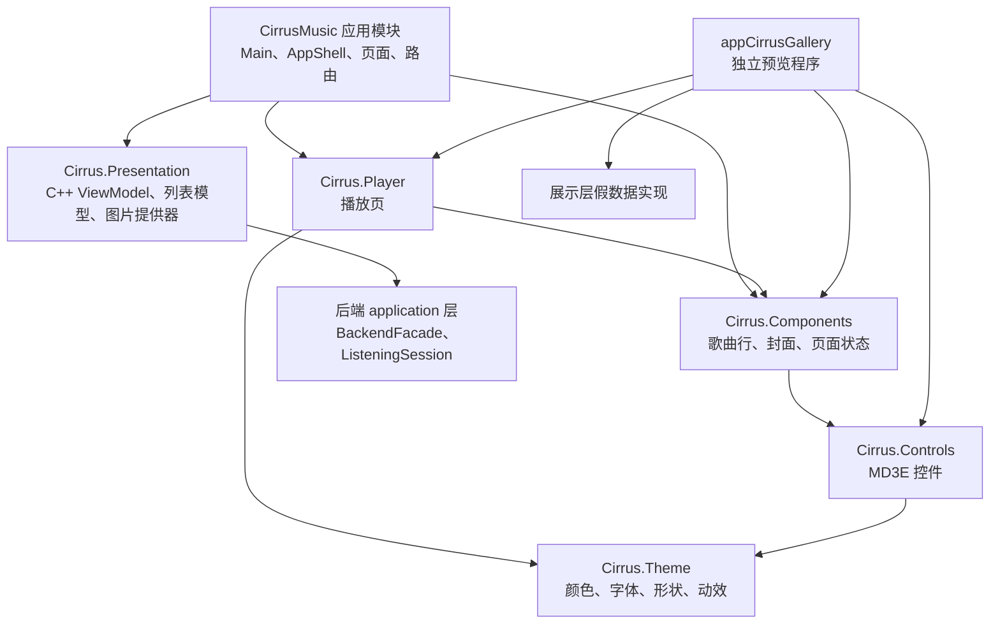

# Cirrus UI 技术方案

> 状态：草案（Draft），待维护者评审。日期：2026-10-17。
>
> 本文是 UI 部分的总体技术方案，回答“UI 用什么风格、怎样分层、按什么顺序做、每一步交付什么”。各阶段开始前会在本目录补充细化文档（见 §13）。本文写到的能力都是计划，不代表已实现。

## 0. 与现有文档的关系

- [07 QML 与设计系统](../07-qml-and-design-system.md) 是早期提案。其中关于视觉风格、控件路线和实施顺序的内容由本文替代；两者冲突时以本文为准（待维护者确认后生效）。
- 架构与安全约束继续有效：QML 不接触凭据、Cookie、签名 URL 和协议 DTO；UI 只通过展示层访问后端（见 [03](../03-system-architecture.md)、[11](../11-security-privacy-and-compliance.md)）。
- 后端对外入口是 `BackendRuntime` 提供的 `facade()`、`listening()`、`fm()`、`resourceQueries()`、`resourceCache()`，契约见 [后台生命周期](../api/backend-runtime.md) 和 [HANDOFF](../HANDOFF.md)。UI 不修改这些契约；需要后端补能力时单独提出。

## 1. 目标与非目标

**目标**

- 跨平台桌面客户端：Linux 优先适配和验证，Windows、macOS 保持可构建、可运行，在有设备后逐项验证。
- 外壳与常规页面采用 **Material 3 Expressive（MD3E）** 风格；**播放页**采用接近 Apple Music 的沉浸式风格；两者属于同一套产品语言，不割裂。
- 基于 Qt 6.11.2（当前已验证 Kit），C++20 + Qt Quick。
- 先用假数据做出可运行的原型并定型，再接入真实业务接口。

**非目标**

- 不复刻 Google 或 Apple 的官方素材：不使用 SF Symbols、SF Pro、Apple 图标或界面截图素材。
- 不使用 Qt 自带的 Material 样式作为成品（它没有 MD3E 的形状、动效和组件）。
- 不引入 WebEngine、Electron 或第三方整套 UI 框架。

## 2. 设计语言

### 2.1 两种语言的分工

| | 外壳与常规页面 | 播放页 |
| --- | --- | --- |
| 风格 | MD3E | 接近 Apple Music |
| 适用范围 | 导航、首页/发现、搜索、音乐库、详情页、设置、登录、迷你播放条、对话框、菜单 | 全屏播放页：封面、歌曲信息、播放控制、进度、音量、歌词、队列面板 |
| 颜色 | MD3 色调方案（surface 容器层级、primary/secondary/tertiary） | 封面取色生成的流动模糊背景，前景以白色系为主 |
| 控件 | 带容器的按钮、色调层级、形状变形 | 无容器的图标按钮、细进度条、大字号歌词 |
| 信息密度 | 中到高 | 低，内容（封面、歌词）优先 |

### 2.2 统一手段

两种风格共享以下五项，用来保证切换时不割裂：

1. **颜色来源可以统一。** 外壳默认以系统强调色为种子生成 MD3 配色；也可选择跟随封面，此时外壳与播放页背景同源。播放页的背景与文字颜色始终从封面另行计算，不使用 MD3 配色。
2. **同一套字体。** 全局一个可变字体家族；播放页只是使用更大字号、更粗字重。
3. **同一套图标。** Material Symbols Rounded。外壳用常规粗细；播放页用填充、加粗、不带容器的版本。
4. **同一套动效参数。** 两边使用同一组弹簧参数（§4.4）。
5. **连续的过渡。** 迷你播放条与播放页之间用共享元素过渡：封面从迷你条位置放大到播放页位置，背景从迷你条颜色铺开。不出现硬切。

### 2.3 播放页内部的边界规则

- 队列、歌词、音量、输出设备、歌词翻译开关属于播放页语言。
- 右键菜单、确认对话框、提示条使用 MD3E 组件，但套用由当前封面派生的深色配色。
- 跳转到歌手、专辑、评论等页面时先退出播放页，回到外壳再导航，不在播放页里嵌入外壳页面。
- MD3E 的异形形状（花瓣、饼干等）只用于外壳；播放页封面使用圆角刻度中的一个克制值。

## 3. 总体架构

### 3.1 分层



- **Cirrus.Theme**：主题单例和取色、配色、弹簧计算的 C++ 实现。不依赖任何业务。
- **Cirrus.Controls**：MD3E 控件。只知道主题，不知道歌曲、账号或 API。
- **Cirrus.Components**：业务展示组件，接收展示数据、发出用户意图。
- **Cirrus.Player**：播放页及其专用组件（背景、歌词视图、播放控制）。不依赖 MD3E 控件，只依赖主题和少量通用组件。
- **Cirrus.Presentation**：C++ 展示层，QML 唯一能看到的数据来源。把后端的异步请求、请求 ID、会话 token 过滤、分页、取消，转换成 QML 可绑定的属性、模型和状态。
- **CirrusMusic**：应用模块，组装页面、导航和窗口。

### 3.2 展示层的接口与假实现

为了避免“先按假数据写页面，接入时返工”，展示层从阶段 3 开始就按最终形态设计：

- 每个 ViewModel 是具体的 QObject 类，对 QML 暴露属性、列表模型和 `Q_INVOKABLE` 意图方法。
- ViewModel 的数据来源是注入的 C++ 接口（如 `SongListSource`）。阶段 3、4 注入假实现（本地示例数据、可模拟延迟和失败）；阶段 5 注入包装 `BackendFacade` 的真实实现。QML 代码不需要改动。
- 所有加载型 ViewModel 使用统一的请求状态：`Idle`、`Loading`、`Ready`、`Empty`、`Error`、`Offline`、`SignedOut`、`Partial`。页面必须为每种状态设计展示。
- QML 只拿到展示用的值和不透明 key（如路由参数、封面 key）；歌曲 ID 等以字符串保存，不做数值运算。
- 真实实现必须遵守后端规则：按请求 ID 和会话 token 丢弃过期结果；离开页面或发起新查询时取消旧请求；换号时清空私有数据。

### 3.3 目录与构建（阶段 0 已确认）

```text
ui/
  CMakeLists.txt  所有 UI 模块输出到 build/<preset>/qml/，便于 qmllint 解析导入
  theme/          Cirrus.Theme：fonts.{h,cpp}（文字字体来源与字重映射、注册随包字体）、Symbols.qml（图标码位，生成）
    fonts/        图标字体子集、MiSans（下载，不进 git）、许可文件、symbols.txt（图标清单）
  controls/       Cirrus.Controls：MD3E 控件、共享基础（状态层、焦点环、阴影、MorphShape）、md.h（Md 枚举）、shaders/（涟漪）
  window/         Cirrus.Window：AppWindow 与标题栏、窗口按钮、缩放边带、WindowFrame（§6.1），应用和 Gallery 共用
  samples/        Cirrus.Samples：虚构示例封面、目录、歌词（生成），只供 Gallery 和假数据实现
  app/            CirrusMusic：main.cpp、Main.qml、窗口与标题栏（§6.1）
  gallery/        appCirrusGallery：Gallery.qml、pages/
  presentation/   Cirrus.Presentation：App 单例、ViewModel、数据源接口与假实现、封面图片提供器（presentation.md）
  components/     Cirrus.Components：页面栈、页面骨架、封面、迷你播放条、PlaybackClock 等业务组件
  （按需新增 player/）
tools/ui/
  prepare_fonts.py      获取固定版本字体（图标、MiSans）、校验 SHA-256、裁剪图标、生成 Symbols.qml
  generate_samples.py   生成示例封面、目录、歌词与 Samples.qml
third_party/
  material-color-utilities/   阶段 1 引入（§4.1）
```

- 每个 QML 模块是一个静态库加 `qt_add_qml_module`；可执行程序链接 `<target>plugin` 并在 `main.cpp` 中 `Q_IMPORT_QML_PLUGIN`。QML 单例需在 CMake 中设置 `QT_QML_SINGLETON_TYPE`。
- 模块在第一次有实际内容时才创建，不建空模块。
- `appCirrusMusic` 与 `appCirrusGallery` 都输出到 `build/<preset>/` 根目录。
- Gallery 由 `CIRRUS_BUILD_GALLERY`（默认开启）控制，不打进发行包。`--grab <文件> [--page 名称] [--size WxH]` 渲染一页并保存截图后退出，可在 `QT_QPA_PLATFORM=offscreen` 下使用。
- 后端库不链接任何 UI 模块；只有展示层的 backend 子目标 `cirrus_presentation_backend` 链接 `cirrus_backend`，`Cirrus.Presentation` 本身和 Gallery 都不链接后端（见 [presentation.md §2](presentation.md)）。
- 生成文件（`Symbols.qml`、`Samples.qml`、字体子集、示例数据）不要手工修改，改生成脚本或其输入后重新运行。

## 4. 主题系统（阶段 1）

### 4.1 颜色

**算法库**：Google 的 [material-color-utilities](https://github.com/material-foundation/material-color-utilities)（Apache-2.0），使用其 C++ 实现：图片量化（Celebi = Wu + WSMeans）、颜色评分、HCT 色彩空间、色调色板和动态配色方案。

阶段 1 需要先处理两个已确认的问题：

1. **依赖 Abseil。** `cpp/quantize/wsmeans.cc` 引用了 `absl/container/flat_hash_map.h`。方案：固定提交后只引入需要的子目录，把这处替换为 `std::unordered_map`，并在 `third_party/material-color-utilities/` 中记录修改和 NOTICE；不为此引入整个 Abseil。
2. **C++ 版本落后。** C++ 的 `DynamicScheme` 没有 TS/Java 版本中的 `SpecVersion`、`Platform` 参数，可能未包含 2025 版（MD3E）配色规则。方案：先用 C++ 版本出原型，对照 TS/Java 版本的输出比较差异；差异明显时，参照 TS/Java 补齐所需的方案变体。

**取色流程**

```text
封面（解码后缩到约 128px）
  → 量化（最多 128 色）→ 评分 → 种子色 + 前几位主色
  → 生成亮色、暗色两套 MD3 配色方案
  → 结果按封面 key 缓存
  → 主题单例以颜色动画过渡到新方案
```

- 取色在后台线程执行（`QThreadPool`），每次请求带递增编号，晚到的旧结果直接丢弃。
- 种子色来源三选一：系统强调色（默认）、当前封面（可选）、固定颜色（UQ-01 已决定）。Linux 通过 xdg-desktop-portal 读取强调色与明暗偏好。
- 亮色/暗色/跟随系统三种模式；跟随系统时监听 `Application.styleHints.colorScheme`。
- 方案变体（TonalSpot、Expressive、Vibrant 等）在原型中比较后确定默认值（UQ-04）。
- 播放页使用同一次取色结果中的主色生成背景，另行计算保证白色文字可读的遮罩强度；对比度按背景最差区域检验。

**主题单例暴露的颜色**：完整的 MD3 角色（primary、onPrimary、primaryContainer……surfaceContainerLowest 至 Highest、outline、inverse、fixed 系列、error 系列）。业务 QML 不直接写颜色值。

### 4.2 字体

- MD3 字体层级：15 个基础样式 + 15 个强调样式（Display、Headline、Title、Body、Label 各大中小）。
- **决定（UQ-03，2026-10-30）：默认使用随包的 MiSans（小米），用户可在设置里改为系统字体或任选一个已安装的字体（`App.settings.fontSource`、`customFontFamily`）。** MiSans 4.009 可变字体（`MiSansVF.ttf`，20 MB，`wght` 150–700）覆盖简繁中文、日文假名、拉丁、希腊、西里尔；缺少的字符（韩文、emoji 等）由系统字体回退。
- MiSans 的许可（`ui/theme/fonts/MiSans-LICENSE.txt`）要求在软件中注明使用了 MiSans、不得修改、不得单独分发，所以：原样入库、原样打包（不裁剪子集，`tools/ui/prepare_fonts.py` 下载并校验 SHA-256），构建时嵌入可执行文件；设置页的字体选项注明“内置字体为小米 MiSans”。缺少字体文件时构建给出警告并改用系统字体，以后据此另出一个不含 MiSans 的小发行包（维护者决定，后话）。
- MiSans 的字重轴可无级调节（150–700），但不是标准刻度（Regular 330、Medium 380、Semibold 520、Bold 630），Qt 也不会把 `QFont` 字重映射到这条轴上（只用默认值，700 及以上还会人为加粗）。所以文字字体统一由 `Fonts.font(weight, pixelSize)` 生成：使用 MiSans 时以命名实例为锚点把 CSS 字重线性插值到轴上（如 450 → 355，仍是连续的，可做字重动画），其他字体照常设置字重。`Theme.type` 的样式都经由它生成，字体切换时整套样式重建并通知；没有设置字体的 `Text` 跟随应用默认字体（同样随设置切换）。QML 里需要特定字重时用 `Fonts.font()`，不要写 `font.weight`。
- 中西文混排时检查基线和行高；播放页歌词以中文为主，字体选择要以中文效果优先。

### 4.3 形状、状态层与高度

- **圆角刻度**：none、extra-small、small、medium、large、large-increased、extra-large、extra-large-increased、extra-extra-large、full，具体数值在阶段 1 按 MD3 官方规范核对后写入主题。
- **形状变形**：MD3E 的标志特性（按钮按下变形、加载指示器在多种形状间变换）。候选方案 [m3shapes](https://github.com/soramanew/m3shapes)（Apache-2.0，androidx graphics-shapes 的 Qt QML 移植，Caelestia 在用）。已在阶段 2 以固定提交 `8a6fe89` 引入（`third_party/m3shapes`，自写静态库 CMake），软件渲染下退回圆角矩形，见 [controls.md](controls.md)。
- **状态层**：悬停 8%、焦点 10%、按下 10%、拖动 16% 的前景色叠加，统一由控件基础组件实现。
- **高度**：用色调层级区分层次，尽量不用阴影（维护者，2026-10-31：浅色模式下用阴影分层显得廉价）。阴影只留给真正浮在内容上的临时浮层（菜单、对话框、搜索建议、提示）；迷你播放条、浮动侧边栏等不加阴影。

### 4.4 动效

**参数**：采用 MD3 动效体系的弹簧参数（阻尼比／刚度），分“空间”（位置、尺寸、缩放，可以回弹）和“效果”（颜色、透明度，不回弹）两类。下表数值来自 androidx Compose material3 的 `MotionScheme` 实现：

| 档位 | 空间：标准 | 空间：Expressive | 效果（两种方案相同） |
| --- | --- | --- | --- |
| 快 | 0.9 / 1400 | 0.6 / 800 | 1.0 / 3800 |
| 默认 | 0.9 / 700 | 0.8 / 380 | 1.0 / 1600 |
| 慢 | 0.9 / 300 | 0.8 / 200 | 1.0 / 800 |

- 小部件（开关、图标）用快档；全屏过渡用慢档；其余用默认档。
- 外壳的标志性动作用 Expressive 空间弹簧，列表、导航等日常动作可用标准空间弹簧，在原型中确认。
- 播放页使用同一张表。

**在 Qt 中的实现**：Qt 的 `SpringAnimation` 参数是 `spring`（0–5）、`damping`、`mass`，语义与“刚度 + 阻尼比”不同，没有直接换算关系。阶段 1 先做实验：

1. 尝试用 `SpringAnimation` 拟合上表曲线，检查曲线形状以及被打断时速度是否连续。它的好处是可以直接用在 `Behavior` 里。
2. 拟合不了时，用 C++ 实现一个弹簧值类型（基于公开 API `QAbstractAnimation`，按解析解逐帧计算，重新设定目标时保留当前速度），对 QML 暴露 `value`、`target`、`stiffness`、`dampingRatio`。代价是不能写在 `Behavior` 里，需要用绑定 `x: spring.value` 的方式使用。

**实验结论（阶段 1）**：`SpringAnimation` 以固定 16 ms 欧拉积分并截断 damping，无法还原上表曲线，因此采用第 2 种方案（`Spring` 元素），另为每个令牌提供 `duration` 与对应缓动曲线供普通动画使用。详见 [theme.md §6](theme.md)。

**减少动态效果**：全局开关。开启后空间动画改为短时淡入淡出，播放页背景静止，歌词不做逐字弹跳和模糊动画。各平台系统设置的读取方式待验证，至少提供应用内开关。

### 4.5 主题 API（草图）

```qml
// 用法示意，最终命名在阶段 1 确定
Rectangle {
    color: Theme.color.surfaceContainer
    radius: Theme.shape.large
}
Text {
    font: Theme.type.titleMedium
    color: Theme.color.onSurface
}
```

## 5. MD3E 控件（阶段 2）

- 控件基于 `QtQuick.Templates` 编写，只重画外观，保留 Qt 的键盘、焦点、输入法、无障碍等行为。不用 Rectangle + MouseArea 拼按钮。
- 不注册全局 QQuickStyle；业务代码只导入 `Cirrus.Controls`，不同时导入 `QtQuick.Controls`，以避免同名类型冲突。控件不加前缀（已决定，见 [controls.md](controls.md)）。
- 每个控件从第一版起就具备：全部交互状态、键盘操作、可见焦点、读屏名称（`Accessible.name`）、`qsTr` 文案、减少动态效果下的表现。
- 每个控件在 Gallery 中有独立页面，展示所有状态和亮暗两套主题。
- 各控件规格（尺寸、颜色、形状、动效）见 [controls.md](controls.md)。

**第一批（核心）**：Button（filled、tonal、outlined、text、elevated，含 MD3E 尺寸档）、IconButton、ToggleButton 和按钮组、Switch、Checkbox、RadioButton、TextField、SearchBar、Slider、线性和环形进度指示器、加载指示器、ListItem、Menu、Tooltip、ScrollBar。

**第二批（按页面需要）**：Dialog、Snackbar、Chips、Tabs、NavigationRail（展开/收起）、Card、Divider、Badge、下拉选择。

## 6. 外壳与页面（阶段 3）

### 6.1 窗口与标题栏（UQ-02）

| 方案 | 做法 | 优点 | 代价 |
| --- | --- | --- | --- |
| A 原生标题栏 | 默认窗口 | 最简单，各平台行为正确 | 标题栏与 MD3E 内容视觉脱节；GNOME Wayland 下由 Qt 绘制客户端装饰，需要随 Qt 部署 qtwayland 的 adwaita 装饰插件才好看 |
| B 扩展客户区 | Qt 6.9 起的 `Qt.ExpandedClientAreaHint` + `Qt.NoTitleBarBackgroundHint`，配合 `SafeArea` 避让系统按钮 | 保留系统按钮和窗口行为，内容延伸到标题栏区域 | 各平台支持程度不同，Linux 上的效果需验证 |
| C 完全自绘 | 无边框窗口，`startSystemMove()`／`startSystemResize()` 处理拖动和缩放 | 三平台外观完全一致 | 需要自己处理缩放边缘、阴影、双击最大化；Windows 贴靠布局和 macOS 红绿灯需要额外处理 |

**更新（2026-10-31，维护者）：标题栏那一行改为应用的顶栏，任何模式下都在；三种模式改为只决定窗口装饰——应用绘制（默认，即原"自绘"）、无（原"隐藏"：没有窗口按钮、阴影和圆角，但保留顶栏、拖动和缩放边带；平铺窗口管理器默认）、系统（迫不得已时用）。设计见 [pages/shell.md](pages/shell.md)。下面是原决定，按此理解。**

**已决定（UQ-02）：标题栏有自绘、系统、隐藏三种模式。默认自绘；平铺窗口管理器（niri、sway、Hyprland、river、i3、dwl）默认隐藏。用户可以在设置里改成任一模式**，用来绕开个别桌面环境下自绘窗口的问题。

- **自绘（默认）**：Linux、Windows 用方案 C，外壳顶部自己画窗口按钮，并处理拖动、缩放边缘、双击最大化。macOS 优先用方案 B，保留系统红绿灯。阶段 3 的窗口原型要在 Linux 的 Wayland 和 X11 上，分别在 GNOME、KDE、niri 下检查阴影、缩放边缘和贴边。
- **系统标题栏**：使用原生窗口装饰，外壳不画自己的标题栏。
- **标题栏那一行**：窗口标题只在自绘模式显示。原来放在标题栏区域的应用内容（返回、搜索等）在系统、隐藏模式下留在内容区顶部；没有这类内容时整行收起，内容从窗口顶部开始。GNOME Wayland 下的装饰由 Qt 绘制（见上表方案 A）。
- **隐藏标题栏**：无边框，没有标题栏、窗口按钮、阴影和圆角；只保留窗口内侧的缩放边带（平铺窗口管理器里可以拖边调整列宽）。平铺窗口管理器靠快捷键管理窗口、自己画边框和圆角，标题栏的功能在那里用不上。按 `XDG_CURRENT_DESKTOP` 判断，名单在 `ui/window/title_bar_mode.cpp`。
- **切换入口**：设置项 `App.settings.titleBar`（[presentation.md §5.1](presentation.md)），用户没改过时按桌面取默认值。另外提供启动参数 `--titlebar=custom|system|hidden` 和环境变量 `CIRRUS_TITLEBAR`（优先级：启动参数 > 环境变量 > 设置 > 默认值）：某个模式出问题、连设置页都操作不了时，不进设置也能换模式。Gallery 接受同样的参数，`--grab` 截图时默认自绘，不受桌面影响；侧栏有“标题栏”切换（不重启），交互运行时记住上次的模式。
- 切换后先按“重启生效”实现；能否不重启、直接重建窗口，在原型中确定。
- 播放页：自绘模式下延伸到标题栏区域，窗口按钮的颜色跟着播放页变化（[motion-choreography.md §2.2](motion-choreography.md)）；系统模式下从标题栏下方开始。

**窗口原型（阶段 3 第 1 步，2026-10-30）**：代码在 `ui/window/`（QML 模块 `Cirrus.Window`，应用和 Gallery 共用）。`AppWindow` 是带框架的顶层窗口，`titleBar` 取 `TitleBarMode.Custom／System／Hidden`，`titleContent` 放标题栏区域的应用内容，默认子项放在标题栏下方；内部由 `TitleBar`（拖动移动、双击最大化、右键窗口菜单）、`WindowButtons`、`ResizeHandles`（8 个缩放边带）和 C++ 的 `WindowFrame`（平台部分）组成。

- **Wayland**：窗口四周留 24 px 透明边距画阴影，用 Qt 私有接口 `setCustomMargins` 把它排除在窗口几何之外，贴边、平铺都按可见窗口计算；`setMask` 把输入区域限制为可见窗口外扩 8 px（缩放边带），阴影处的点击落到下面的窗口。最大化、全屏、平铺时边距为 0、直角。圆角 `Theme.shape.medium`，另加 1 px 半透明 outlineVariant 描边，暗色下阴影看不清时仍能分辨窗口边缘。
- **私有接口**：平铺状态、自定义边距、窗口菜单在 Qt 中没有公开 API，只在 `window_frame.cpp` 里通过 `Qt6::WaylandClientPrivate` 使用（找不到该模块时退化为无阴影）。私有接口不保证跨版本兼容，换 Qt 版本要重新编译并复查。
- **X11、Windows**：不依赖合成器透明，没有阴影、直角，缩放边带只在窗口内侧 4 px。Windows 未验证。
- **macOS**：方案 B（`ExpandedClientAreaHint` + `NoTitleBarBackgroundHint`），不画窗口按钮和缩放边带，标题栏左侧为红绿灯留 72 px（估计值）。未验证。
- **内容规则**：圆角处只画窗口底色，子项不要画到圆角区域；铺满窗口的内容（播放页背景）自己按 `window.cornerRadius` 裁圆角。
- **不重启切换**：隐藏窗口 → 改 flags → 重新显示，原生窗口重建。niri 上可行（尺寸、状态保留）；GNOME、KDE 待验证，通过后设置项改为立即生效。原型页面有切换按钮。
- **niri 的发现**：默认配置下 niri 不发送平铺状态（configure 的 states 为空），平铺时仍有阴影和圆角，与 GTK 应用在 niri 上的表现一致；该会话也不提供 xdg-decoration，系统标题栏模式下由 Qt 自绘装饰（bradient），与 GNOME 情况相同。
- **窗口按钮图标**：最小化用 `remove`（居中横线；Material 的 `minimize` 贴底，与另两个图标不对齐）、最大化 `crop_square`、还原 `filter_none`、关闭 `close`。
- **以后再做**：窗口按钮位置跟随系统设置（如 GNOME 的按钮布局，维护者决定先不做），目前固定在右侧；播放页下窗口按钮的颜色过渡留到阶段 4。

桌面检查清单（拖动、双击最大化、右键菜单、各边缩放和光标、阴影、贴边／平铺、最大化后直角、三种模式切换、默认模式）：

| 环境 | 结果 |
| --- | --- |
| niri（Wayland） | 默认隐藏；窗口几何、输入区域、最小尺寸、不重启切换已用协议日志和窗口截图确认；交互项待维护者检查 |
| niri（X11，XWayland） | 能启动；交互项待检查 |
| GNOME、KDE（Wayland、X11） | 待检查 |

### 6.2 布局与响应式

- 按 MD3 窗口尺寸分级：compact（<600）、medium（600–839）、expanded（840–1199）、large（1200–1599）、extra-large（≥1600），桌面端主要处理 medium 及以上，compact 下保证播放、导航、退出可用。
- 主体结构：导航栏（NavigationRail，可展开/收起）+ 内容区 + 可选的辅助面板（如队列）+ 底部常驻迷你播放条。
- 导航：自建页面栈，路由使用类型化参数（如歌单路由带歌单 key），返回时恢复滚动位置；页面缓存设上限，不让所有页面常驻；换号时清除私有页面的历史。

### 6.3 页面清单（第一轮）

首页/发现、每日推荐、私人 FM 入口、搜索（建议、热搜、分类结果）、音乐库（喜欢、歌单、收藏、最近播放）、歌单/专辑/歌手详情、评论、登录（二维码）、设置。

### 6.4 页面状态

每个页面都要设计：首次加载（骨架屏）、刷新、空、错误（带重试）、离线、未登录、部分数据。这些状态做成 `Cirrus.Components` 里的通用组件，阶段 3 随页面一起交付。

### 6.5 参考

布局参考社区现成方案，阶段 0 的参考调研清单逐项给出“借鉴什么、许可是什么、能否借代码”。初步名单：

| 项目 | 许可 | 借鉴内容 | 代码 |
| --- | --- | --- | --- |
| [illogical-impulse（end-4/dots-hyprland）](https://github.com/end-4/dots-hyprland) | GPL-3.0 | MD3 配色运用、密度、动效手感、媒体控件 | 不复制 |
| [Caelestia shell](https://github.com/caelestia-dots/shell) | GPL-3.0 | MD3E 形状与动效、媒体面板 | 不复制 |
| [Noctalia](https://github.com/noctalia-dev/noctalia) | MIT | MD3 配色组织方式 | 已改为不依赖 Qt 的 C++ 实现，代码参考价值低 |
| [YesPlayMusic](https://github.com/qier222/YesPlayMusic) | 主分支 MIT（v2 分支为 AGPL-3.0） | 网易云客户端的信息结构、Apple Music 风格播放页 | 技术栈不同，主要借鉴设计 |
| [AMLL](https://github.com/amll-dev/applemusic-like-lyrics) | AGPL-3.0 | Apple Music 风格逐字歌词效果 | 不复制 |

illogical-impulse 与 Caelestia 基于 Quickshell，本身就是 QML 实现，参考价值高；但它们是桌面外壳而不是应用，应用的信息结构还要参考音乐客户端。项目自身许可证尚未确定，确定前不复制任何 GPL/AGPL 代码。完整清单（含 MD3 音乐客户端与播放页参考）见 [references.md](references.md)。

## 7. 播放页（阶段 4）

### 7.1 结构

- 背景层、封面、歌曲信息、播放控制（上一首、播放/暂停、下一首、播放模式）、进度条、音量、歌词、队列面板。
- 宽窗口：封面与歌词左右分区；窄窗口：封面视图与歌词视图切换。断点在原型中确定。

### 7.2 背景

- 方案 1：放大并高斯模糊的封面（`MultiEffect`），实现简单、开销低。
- 方案 2：用取色得到的主色驱动的流动渐变（自定义 `ShaderEffect`，经 ShaderTools 编译为各图形后端可用的着色器），更接近 Apple Music。
- 两种方案都在降低分辨率的纹理上渲染；暂停播放、窗口最小化或不可见时停止动画；减少动态效果模式下使用静态背景。

### 7.3 歌词视图

- 数据来自 `ListeningSession` 的歌词状态和游标（原文、翻译、音译、逐字等六轨）。
- 当前行突出（字号、字重、透明度），其余行按与当前行的距离逐渐淡化；模糊只作用于可见范围内少量行，并能整体关闭。
- 逐字高亮：用文字裁剪或渐变遮罩实现填充推进，逐字时间不可用时降级为逐行。
- 用户手动滚动后进入浏览模式，暂停自动跟随，提供“回到当前行”；点击某行在可跳转时发出跳转意图。
- 无歌词、纯音乐、加载失败、权限不足分别展示，不显示空白。

### 7.4 控制区

- 图标按钮不带容器，按下有缩放反馈。
- 进度条默认细，悬停或拖动时变粗；拖动期间发出“预览位置”，松手后才发出“跳转”，期间不被播放进度拉回。

## 8. 过渡编排

以下跨组件动画的编排说明（时间线、谁先动谁跟随、使用哪档弹簧、被打断时如何处理）见 [motion-choreography.md](motion-choreography.md)：

- 迷你播放条 ↔ 播放页：封面共享元素过渡、背景铺开、控件淡入。实现上在外壳之上放一个覆盖层，用 `mapToItem` 交接封面的起止位置和尺寸。Esc 和返回操作可以中途打断并反向。
- 页面切换与返回。
- 切歌时的取色过渡（外壳与播放页同时）。
- 导航栏展开与收起。

## 9. 图片管线

- C++ 异步图片提供器（`QQuickAsyncImageProvider`），QML 使用不透明 key（如 `image://cover/<key>/<尺寸>`），不出现真实 URL。
- 按显示尺寸解码，内存缓存设上限；占位图尺寸稳定，加载失败时页面不跳动。
- 同一次解码结果同时供取色使用，避免重复解码。
- 原型阶段由本地示例封面提供；阶段 5 接入后端的 `ResourceCacheService`／封面获取能力。后端在 `resourceCacheRoot` 为空时关闭封面缓存，接入时需要确定缓存目录（UQ-06）。

## 10. 跨平台

| 事项 | 处理方式 |
| --- | --- |
| 图形后端 | Qt RHI：Linux 为 Vulkan/OpenGL，Windows 为 D3D11，macOS 为 Metal。自定义着色器通过 ShaderTools 生成各后端版本 |
| 字体 | 文字默认用随包的 MiSans，各平台一致；用户选系统字体时观感随平台不同（UQ-03）。图标字体随包附带 |
| 标题栏 | 见 §6.1 |
| 快捷键 | 使用 `StandardKey`，自定义快捷键按平台区分 Ctrl 和 Cmd |
| 缩放 | 测试 100%/125%/150%/200%，以及 Wayland 分数缩放 |
| 深浅色与强调色 | 读取系统设置，各平台分别验证 |
| 触控板滚动 | Linux、macOS 惯性滚动的手感分别调校 |
| 托盘、通知、菜单栏 | 阶段 6 处理；macOS 全局菜单栏另行评估 |

当前只有 Linux 设备。每个阶段在 Linux 上验收，Windows、macOS 的验证记录为待办，不宣称已支持。

## 11. 资源与许可

| 资源 | 许可 | 用途 | 状态 |
| --- | --- | --- | --- |
| Material Symbols Rounded | Apache-2.0 | 全局图标（可变字体：填充、字重、等级、光学尺寸） | 候选，阶段 0 确认是否裁剪子集 |
| MiSans 4.009（可变字体） | MiSans 字体知识产权许可协议（免费商用；须注明使用、不得修改、不得单独分发） | 默认文字字体 | 已采用（UQ-03）：不进 git，`prepare_fonts.py` 下载后构建时嵌入，见 `ui/theme/fonts/README.md` |
| material-color-utilities | Apache-2.0 | 取色与配色方案 | 已引入固定提交 `5b3618b1`（C++，3 处本地修改），见 `third_party/material-color-utilities/README.md` |
| m3shapes | Apache-2.0 | MD3E 形状与变形 | 已引入固定提交 `8a6fe89`（未修改源码，自写 CMake），见 `third_party/m3shapes/README.md` |

所有随包分发的字体和代码在 `third_party/` 或资源目录中保留许可文件，并登记到依赖清单（见 [02](../02-technology-stack.md) 的依赖准入要求）。

## 12. 阶段计划

**当前进度（2026-10-31）**：阶段 0、1 和阶段 2 第一批控件已完成，Gallery 的 VS Code 预览任务已就绪（`Gallery: watch`）。阶段 3 的两份前置文档（[过渡编排](motion-choreography.md)、[展示层接口](presentation.md)）已写完，标题栏方案已决定（UQ-02，§6.1）。阶段 3 第 1 步窗口原型的代码已完成，等待维护者在各桌面上做交互检查（§6.1 的清单）；第 2 步展示层骨架、第 3 步外壳已完成；第 4 步的通用组件与展示层模型已完成，§6.3 各页面已有未经设计的原型（§15），**按维护者要求改为先设计后实现：首页和外壳（侧边栏、顶部搜索）的设计与第一版已完成（[pages/home.md](pages/home.md)、[pages/shell.md](pages/shell.md)），已按反馈修改；歌单详情页设计已评审（[pages/playlist.md](pages/playlist.md)，2026-11-01），实现分三步，第一步（页面本体）和第二步（红心与写操作）已完成，下一步是大歌单按页补详情（playlist.md §12），之后逐个设计其余页面**。文字字体已定为 MiSans（UQ-03）。阶段 3 建议顺序：
1. 窗口原型：自绘标题栏与系统标题栏切换（§6.1），在 Linux 各桌面上检查。**代码已完成，桌面检查进行中。**
2. `Cirrus.Presentation` 骨架：`App` 单例、`LoadState`、数据源接口与假实现（presentation.md §2–§7）；`Theme.motion` 加 `segment()`／`lerp()`。**已完成**（presentation.md §10）。
3. 外壳：导航栏（需要第二批的 NavigationRail）、页面栈与切换动画、迷你播放条。**已完成**（§15）。
4. `Cirrus.Components` 的页面状态组件和歌曲列表，再逐个做 §6.3 的页面；其余第二批控件按页面需要再做。**通用部分已完成；页面先出设计、经维护者确认后再实现（现有页面只是原型）。**

| 阶段 | 交付内容 | 完成条件 |
| --- | --- | --- |
| 0 工程基础（**已完成**，见 §15） | `ui/` 目录和各 QML 模块的 CMake；Gallery 空壳；字体、图标入库及许可文件；示例封面和示例数据；参考调研清单 | Linux 上 Debug/Release 构建通过，Gallery 能启动，qmllint 无错误 |
| 1 主题系统（**已完成**，含 2025 配色规范移植，见 §15） | material-color-utilities 引入与改造；后台取色；主题单例（颜色、字体、形状、状态层、动效）；弹簧实验报告；Gallery 主题页（切换封面/种子色/亮暗，查看配色、字体层级、圆角、动效） | 切换封面时配色平滑过渡且不卡顿；文字与背景对比度达标 |
| 2 MD3E 核心控件（**第一批已完成**，见 §15） | §5 第一批控件及 Gallery 页面 | 每个控件的状态、键盘、焦点、读屏名称在 Gallery 中可检查 |
| 3 外壳与页面 | 先写过渡编排说明和 ViewModel 接口说明；窗口方案对比；导航、响应式、迷你播放条、§6.3 页面及其状态；展示层假实现 | 用假数据走通主要页面和导航，所有页面状态可在 Gallery 或调试开关中触发 |
| 4 播放页 | 背景、封面、控制区、歌词视图、队列面板，以及与迷你条的过渡 | 用示例歌词和模拟播放进度完整运行；减少动态效果模式正常 |
| 5 业务接入 | 展示层真实实现、封面图片提供器、`main.cpp` 组装 `BackendRuntime`；按功能逐个接入：启动与登录 → 搜索 → 歌单/专辑详情 → 播放、队列与歌词 → 音乐库 → 发现 → 评论等 | 每个功能接入后在真实后端下走通，加载、错误、取消、换号行为正确 |
| 6 打磨 | 动效一致性、性能（长列表、模糊开销）、无障碍、三平台验证、托盘/通知/快捷键 | 待阶段 5 结束时细化 |

阶段 4 只依赖阶段 1，可以与阶段 2、3 并行。

## 13. 细化文档计划

| 文档 | 编写时机 |
| --- | --- |
| [`docs/ui/references.md`](references.md) 参考调研清单 | 阶段 0（已完成） |
| [`docs/ui/theme.md`](theme.md) 主题系统与弹簧实验结果 | 阶段 1（已完成） |
| [`docs/ui/controls.md`](controls.md) 控件清单与各控件规格 | 阶段 2（已完成第一批） |
| [`docs/ui/motion-choreography.md`](motion-choreography.md) 过渡编排说明 | 阶段 3 开始前（已完成） |
| [`docs/ui/presentation.md`](presentation.md) ViewModel 与数据源接口 | 阶段 3 开始前（已完成） |
| `docs/ui/pages/*.md` 各页面设计（[首页](pages/home.md)、[外壳](pages/shell.md)已实现；[歌单详情](pages/playlist.md)待评审） | 每个页面实现前 |
| `docs/ui/player.md` 播放页规格 | 阶段 4 开始前 |

## 14. 待决问题

| 编号 | 问题 | 当前倾向 | 需要在何时决定 |
| --- | --- | --- | --- |
| UQ-01 | 外壳种子色默认来源 | **已决定**：默认系统强调色，封面取色为可选项；播放页另行从封面取背景与文字颜色、不用 MD3 配色 | 已决定 |
| UQ-02 | 窗口标题栏方案（§6.1） | **已决定**：顶栏始终在；窗口装饰三选一：应用绘制（默认）／无（平铺窗口管理器默认）／系统（退路）；设置中可改，另有启动参数作为逃生通道（2026-10-31 更新） | 已决定 |
| UQ-03 | 文字字体：系统字体还是随包附带 | **已决定（2026-10-30）**：默认随包 MiSans，用户可选系统字体或自定义字体，见 §4.2 | 已关闭 |
| UQ-04 | 默认配色方案变体 | 暂定 TonalSpot；2025 规范下 Expressive 已保持种子色相，可在原型中比较 | 阶段 3 |
| UQ-05 | 播放页在亮色主题下是否仍使用深色背景、浅色文字 | 倾向始终深色，与 Apple Music 一致 | 阶段 4 开始 |
| UQ-06 | 应用身份（app ID）、配置与缓存目录 | 原型阶段用开发占位值 | 阶段 5 开始 |
| UQ-07 | UI 是否编写 Qt Quick Test 自动化测试 | **已决定**：不写，以 Gallery 人工检查（交互 + 离屏截图）为准 | 已决定 |
| UQ-08 | m3shapes 直接依赖还是自行移植 | **已决定**：以固定提交引入、自写静态库 CMake，软件渲染下降级 | 已决定 |
| UQ-09 | 配色规范版本 | **已决定**：采用 2025 规范，已移植到 C++ 并与 TS 逐色验证（[theme.md §3](theme.md)） | 已决定 |

## 15. 实施记录

### 阶段 0：工程基础（2026-10-17）

**交付**

- `ui/` 目录与 `Cirrus.Theme`、`Cirrus.Controls`、`Cirrus.Samples`、`CirrusMusic`、`CirrusGallery` 五个 QML 模块，结构见 §3.3；原根目录的 `main.cpp`、`Main.qml` 已迁入 `ui/app/`，可执行文件位置不变。
- 随包字体：Material Symbols Rounded 2.973 的 96 个图标子集（171 KB，保留全部可变轴），来源、SHA-256 与修改说明见 `ui/theme/fonts/README.md`。文字使用系统字体（最初引入的 Google Sans Flex 已按维护者意见撤出）。
- 虚构示例数据：12 张程序绘制的封面、13 张专辑／38 首歌曲／5 个歌单、2 份带翻译与逐字时间的歌词，说明见 `ui/samples/README.md`。
- Gallery 资源页：系统字体的字重 Thin–Black，中文／日文／希腊／西里尔／emoji 混排，全部图标（可调填充、字重、尺寸），全部示例封面。
- [参考调研清单](references.md)。

**验证（Linux，Qt 6.11.2）**

- Debug、Release 下 `appCirrusMusic`、`appCirrusGallery`、`cirrus_backend` 构建无警告；`all_qmllint` 无警告。
- `QT_QPA_PLATFORM=offscreen` 下 Gallery 截图检查：系统字体与中文（Noto Sans CJK SC）按 `font.weight` 选取相近字重；日文、希腊、西里尔、emoji 正常回退；图标填充和字重轴生效。离屏模式没有桌面平台主题，系统字体显示为通用名 `Sans Serif`，真实桌面会话中取 GNOME/KDE 设置的字体。`appCirrusMusic` 离屏启动正常（仍是模板窗口）。
- 新增 C++ 文件通过 clang-format 检查。
- 未在 Windows、macOS 上构建或运行。

**发现的问题**

- 全量构建中后端测试 `tests/unit/entity_search_test.cpp:42` 编译失败：`detail::aes` 同时匹配 `cirrus::netease::detail` 与 `backend_facade.h` 中的 `cirrus::application::detail`。该问题来自后端提交 `2c164a7`（评论写入 Facade 拆分）引入的 `namespace detail`，与 UI 改动无关，UI 侧未修改后端代码。其余目标全部构建通过。
- Google Sans Flex 4.005 只覆盖 535 个拉丁字符，商标说明限制修改版使用其名称；已不打包，记录保留在 `ui/theme/fonts/README.md`。
- QML 中 `onXxx` 形式的名字与信号处理器冲突，MD3 颜色角色名需在阶段 1 规避，详见 [references.md §6](references.md)。

### 阶段 1：主题系统（2026-10-18）

**交付**（详见 [theme.md](theme.md)）

- 引入 material-color-utilities C++（固定提交 `5b3618b1`，去掉 Abseil、补一处缺失 include），独立静态库 `cirrus_mcu`，只被 UI 链接。
- `Theme` 单例：封面取色（私有工作线程、过期结果丢弃）、三种种子来源、9 种方案变体、明暗模式、对比度；49 个颜色角色在 CAM16-UCS 中按 `defaultEffects` 弹簧过渡；近灰种子自动使用 Monochrome。
- 令牌：MD3 30 个字体样式（androidx TypeScaleTokens）、圆角刻度、状态层、高度、9 个弹簧动效令牌（androidx MotionScheme）及减少动态效果开关。
- `Spring` 元素：解析解逐帧计算、改目标时保持速度；每个令牌另提供 `duration` 与缓动曲线。
- Gallery 改用主题；新增“主题”页（封面、种子来源、变体、明暗、对比度、全部角色、对比度检查、字体层级、圆角、状态层、弹簧曲线与对照）；新增 `--cover`、`--mode` 参数。

**验证（Linux，Qt 6.11.2）**

- Debug、Release 下 UI 目标与 `cirrus_backend` 构建无警告；`all_qmllint` 无警告；新增 C++ 文件通过 clang-format。
- 12 张示例封面取色每张 1–7 ms；亮暗模式下 12 组文字／背景对比度均 ≥ 6.1。
- `Spring` 与解析解最大偏差 0.5 px，改目标前后速度连续（336 → 336 px/s）。
- C++ 配色与 TS 2021 版逐色一致（ΔE 0）。
- 未在 Windows、macOS 上构建或运行；系统强调色未在真实桌面会话中验证。

**发现的问题**

- C++ 版只有 2021 配色规范，与 MD3E 使用的 2025 规范差异明显（Expressive 中位 ΔE 约 74–83），需要决定是否移植（UQ-09）。
- 离屏截图默认走 software 渲染，自定义着色器不会绘制；检查着色器需 `QT_QUICK_BACKEND=rhi QSG_RHI_BACKEND=opengl`。

### 阶段 1 补充：2025 配色规范与系统强调色（2026-10-19）

- 2025 规范从 TS 移植到 C++（`third_party/material-color-utilities/cirrus/`），与同一提交编译的 TS 比较 1,649,840 个颜色，84 个有 1 个通道单位的舍入差异；Release 下一套方案约 0.8 ms。
- 新增 primaryDim、secondaryDim、tertiaryDim、errorDim 四个角色（共 53 个）；`Theme.specVersion` 可切回 2021。
- 种子默认改为系统强调色。Qt 6.11 在 Linux 上不读取 portal 强调色，新增 `SystemAppearance` 经 D-Bus 读取 `org.freedesktop.appearance`（强调色、明暗）并跟随变化；niri 会话中验证通过。
- Debug/Release 构建、qmllint 无警告；截图检查对比度仍 ≥ 6.1。

### 阶段 2：MD3E 核心控件第一批（2026-10-25）

- 决定：控件不加前缀；不写 Qt Quick Test（UQ-07）；m3shapes 以固定提交引入并在软件渲染下降级（UQ-08）。规格取自 androidx compose material3 的令牌与 `*Defaults` 实现，见 [controls.md](controls.md)。
- 共享基础：`StateLayer`（悬停／焦点叠加 + 着色器涟漪，四角半径独立）、`FocusRing`、`Elevation`（`RectangularShadow`）、`MorphShape`；`Theme.mix` 与 `Theme.motion.custom`。状态颜色用“弹簧进度 + mix”过渡，主题切换时不滞后。
- 控件：Button（5 种样式 × 5 档尺寸 × 圆／方，`checkable` 即切换按钮）、IconButton、StandardButtonGroup／ConnectedButtonGroup、Switch、CheckBox、RadioButton、TextField、SearchBar、Slider、ProgressBar、CircularProgress、LoadingIndicator、ListItem、Menu／MenuItem／MenuSeparator、ToolTip、ScrollBar。
- Gallery 新增“按钮”“选择与输入”“进度”“列表与菜单”四页；`--grab` 时自动打开菜单与提示以便截图。Gallery 只剩 ComboBox、ScrollView 和窗口仍来自带命名空间的 Basic 样式。
- 验证：Debug/Release 构建无警告，qmllint 无警告；亮暗主题、RHI 与软件渲染下逐页截图检查。键盘焦点与按下状态用 Gallery 中强制状态的示例静态检查；悬停、拖动、键盘操作需在桌面上交互确认。Windows/macOS 未验证。


### 阶段 3 准备：前置文档与标题栏决定（2026-10-26）

- 新增 [motion-choreography.md](motion-choreography.md)：令牌选择规则、单一进度弹簧驱动加区间映射（打断时整体反向）、减少动态效果版本；迷你条 ↔ 播放页、页面切换、切歌换色、导航栏展开四类过渡的时间线。
- 新增 [presentation.md](presentation.md)：`App` 单例与页面 ViewModel、统一请求状态及 `MusicError` 映射、请求生命周期与换号规则、数据源接口、假实现调节项、阶段 5 的后端对照表。展示层拆为不链接后端的 `cirrus_presentation` 和链接后端的 `cirrus_presentation_backend`。
- UQ-02 已决定：默认自绘标题栏，可切换为系统标题栏（§6.1）。

### 阶段 3 第 1 步：窗口原型（2026-10-30）

- `appCirrusMusic` 不再是 Qt 模板：`Window` + 自绘标题栏（默认）／系统标题栏，`--system-titlebar` 与 `CIRRUS_SYSTEM_TITLEBAR=1` 可切到系统标题栏；内容区暂为原型页（显示标题栏模式、平台、窗口状态、阴影边距，可不重启切换模式）。实现与发现见 §6.1。
- 新增图标 `minimize`、`crop_square`、`filter_none`（窗口按钮），共 99 个。
- 设置项 `App.settings.titleBar` 随第 2 步的展示层骨架接入；目前只有启动参数和环境变量。
- 验证：Debug 构建无警告，qmllint 无警告，clang-format 通过；离屏（软件渲染）两种模式启动无 QML 警告；niri Wayland 会话中用协议日志确认窗口几何 `(24, 24, 1000, 1074)`、输入区域、最小尺寸与不重启切换，用窗口截图确认阴影与圆角；XWayland 下能启动。拖动、缩放、双击、右键菜单等交互未检查；GNOME、KDE、Windows、macOS 未验证。
- 随后按维护者意见调整（同日）：窗口框架移到共用模块 `Cirrus.Window`，Gallery 改用同一个 `AppWindow`；标题栏增加“隐藏”模式，平铺窗口管理器默认隐藏（UQ-02 更新）；启动参数统一为 `--titlebar=custom|system|hidden`／`CIRRUS_TITLEBAR`，替换 `--system-titlebar`；最小化图标改为 `remove`（图标 98 个）。验证：构建、qmllint、clang-format 无警告；Gallery 离屏截图（自绘、隐藏）与 niri 下截图正常；niri 下应用默认隐藏（窗口几何无边距），`--titlebar custom` 恢复阴影边距，非法取值给出警告并忽略。
- 再次调整（同日）：隐藏模式与系统模式下，标题栏那一行没有应用内容时整行收起（此前隐藏模式只去掉了窗口按钮，仍留着一行标题，没有意义）；窗口标题改由 `AppWindow` 只在自绘模式显示。Gallery 侧栏加“标题栏”三选一切换，并记住上次的模式。离屏截图检查自绘、隐藏两种模式正常。

### 阶段 3 第 2 步：展示层骨架（2026-10-30）

- `Theme.motion.segment()`、`lerp()`。
- 新模块 `Cirrus.Presentation`（`ui/presentation/`）：`App` 单例（settings、format、network、debug）、`LoadState`／`Failure`、请求句柄与数据源接口、假数据源、封面图片提供器、`LoadableModel`、`SongListModel`、示范用的 `PlaylistPageModel`，详见 [presentation.md §10](presentation.md)。
- 应用与 Gallery 都装入假数据源；标题栏模式改由 `App.settings.titleBar` 记住（Gallery 原来的临时设置项取消），应用的外观绑定到 `App.settings`。应用暂时链接 `Cirrus.Samples` 供假数据使用。
- Gallery 新增“数据与状态”页（`--page data`）。
- 验证：构建、qmllint（仅 `ButtonContainer.qml` 原有的一条未使用导入提示）、clang-format 无警告；离屏截图检查数据页；临时检查程序跑通 13 项状态转换；应用离屏启动无警告。

### 阶段 3 第 3 步：外壳（2026-10-30）

- 第二批控件 `NavigationRail`、`NavigationRailItem`（MD3E 宽导航栏，收起 96、展开 220–360，展开时指示器与标签一起变形；规格见 [controls.md §8a](controls.md)）。
- 新模块 `Cirrus.Components`（`ui/components/`）：
  - `PageStack`：自建页面栈，`push`／`pop`／`replaceAll`，前进、返回、淡入淡出三种切换，单一进度弹簧驱动、中途可反向；最多缓存 4 个页面，返回时重新创建被释放的页面（[motion-choreography.md §3](motion-choreography.md)）。
  - `PageScaffold`：页面标题行（返回按钮、标题、操作区）加内容区。
  - `CoverArt`：按 key 显示封面，圆角遮罩加占位图标；换封面时等新图解码完成再交叉淡入，最多两层（motion-choreography.md §4.1）。软件渲染下没有遮罩，封面为直角。
  - `PlaybackClock`：按 `App.player` 的位置基准逐帧外推播放位置（`FrameAnimation`）。
  - `MiniPlayer`：悬浮的迷你播放条（封面、标题／歌手或失败原因、上一首／播放暂停／下一首、时间、进度线），有歌曲时从底部滑入；窄于 560 时去掉“上一首”和时间。点击发出 `openRequested`，播放页在阶段 4 接上。
- 应用外壳 `AppShell`：窗口宽 ≥ 1200 时导航栏常驻并推开内容，较窄时收起、展开后浮在内容上并加遮罩；跨越断点时不做动画。目的地为首页、发现、搜索、音乐库、设置，切换目的地清空历史；Esc、返回键、鼠标侧键返回。页面栈下方为迷你播放条留出空间。首页暂为示例歌单入口，发现、搜索、音乐库为占位页（第 4 步实现）。
- 设置页：明暗、主题色来源、减少动态效果、标题栏（立即生效，不重启）、歌词翻译与音译，都存入 `App.settings`。
- 展示层加 `App.player`（`PlaybackSource` 接口、`FakePlayback` 假播放器）与 `SongListModel` 的 `current` 角色，详见 [presentation.md §10](presentation.md)。歌单页点歌曲或“播放全部”开始播放，正在播放的行高亮。
- Gallery：“导航”页（`--page navigation`）演示导航栏三种形态与页面栈；“数据与状态”页加播放区（顺序、循环、进度、迷你播放条），`--grab` 时自动开始播放。
- 待定：“跟随封面”的主题色来源还没有接到当前歌曲的封面（`Theme.cover` 只接受本地文件或 qrc，需要封面缓存给出文件路径），随阶段 4 的切歌换色一起做。
- 验证：构建、qmllint（仅原有的一条提示）、clang-format 无警告；离屏截图检查宽 1300、900 的外壳、歌单页、设置页、播放中与失败状态的迷你播放条；用临时钩子（未提交）检查页面栈的连续前进与返回、中途反向、缓存释放与重建，以及播放的自然结束、列表结束、列表循环、单曲循环和 so-012 失败。

### 阶段 3 第 4 步（进行中）：页面状态、通用列表与页面原型（2026-10-30）

- `Cirrus.Components`：`PageState`（骨架屏、空、错误、离线、未登录，刷新时的加载指示器）、`Skeleton`／`ListSkeleton`、`StateMessage`、`NoticeBar`、`SongList`（分段列表、歌曲菜单、分页）、`CollectionCard`／`CollectionGrid`／`CollectionView`、`LoadMoreFooter`。Gallery 新增“页面状态”页（`--page states`）。
- 第二批控件：`TabBar`／`TabButton`、`Chip`（controls.md §8b）。
- 展示层：专辑、歌手、搜索（建议、热搜、分页结果）、首页／发现、每日推荐、音乐库的页面模型，`PagedModel`、`CollectionListModel`，`App.session`（扫码登录，假实现自动走完流程，二维码为不可扫描的示意图）、私人 FM，以及对应的假数据源。
- 页面原型：首页、发现、搜索、专辑、歌手、每日推荐、音乐库、登录，设置页的“账号”一节。**这些页面没有经过设计评审**，只用于验证模型和组件；维护者要求先设计后实现，正式页面按设计重写。

### 文字字体：MiSans（2026-10-30）

- UQ-03 关闭：默认文字字体改为随包的 MiSans 4.009 可变字体，用户可在设置里改为系统字体或自定义字体（§4.2）。
- `tools/ui/prepare_fonts.py` 从小米官网下载 MiSans 字体包，取出 `MiSansVF.ttf` 并校验 SHA-256（`--skip-misans` 只处理图标字体）；字体原样入库（维护者决定），构建时作为大资源嵌入可执行文件（约 20 MB）。
- `Fonts` 改为全局单例：`source`（内置／系统／自定义）、`customFamily`、`sans`、`bundledAvailable`、`systemFamily`、`font(weight, pixelSize)`、`families()`；`Theme.type` 随字体切换重建。`App.settings` 加 `fontSource`、`customFontFamily`，`Main.qml` 绑定到 `Fonts`；设置页加“字体”选项（自定义时从已安装字体中选）。Gallery 默认使用 MiSans，资源页可临时切换内置／系统字体并显示 100–900 字重。
- 验证：构建、qmllint、clang-format 无警告；离屏截图检查 Gallery 资源页的字重（此前用 `font.weight` 时 100–700 都是同一粗细、700 以上为人工加粗）、混排回退，以及应用设置页切换到系统字体后整页立即更新。

**首页与外壳第一版（2026-10-31）**

- 按 [pages/home.md](pages/home.md) 重写首页：顶部"今日"卡片（大号日期数字，播放今日推荐时字重从 200 弹到 630；前 4 首封面叠放；第一首和推荐理由）和私人 FM 卡片，下面是最近听过（两列分段列表）、每日推荐歌单；未登录时是登录邀请、推荐歌单、新碟上架。各区块分别加载和失败（`HomeSection`）。维护者决定相似歌曲不放首页。
- 按 [pages/shell.md](pages/shell.md) 改外壳：导航目的地只剩首页、发现、音乐库；展开的侧边栏加"我的"和创建／收藏的歌单（可折叠），底部是账号和设置；搜索改为标题栏那一行的入口（Ctrl+K／Ctrl+F）。`NavigationRail` 加 `footer`、`expandedContent`、`minimumExpandedWidth`。
- 展示层：`RecentSongsModel`、`ShelfModel`（`Feed.Shelf`），`DailySongsPageModel.lead`／`coverKeys`，`SongInfo.reason`，`SongListModel.containsCurrent`；数据源加 `CatalogSource::shelf()`、`LibrarySource::recentSongs()`，假数据补齐。
- 私人 FM 卡片原定 `tertiaryContainer`，2025 规范暗色方案里它比"今日"亮很多、喧宾夺主，改为 `surfaceContainerHigh`。
- 验证：构建、qmllint、clang-format 无警告；离屏截图（临时改 `main.cpp` 设置窗口尺寸和执行脚本，未提交）检查了宽、中、窄三档，亮暗两种模式，登录与未登录，播放今日推荐（数字变粗）和私人 FM 播放中。

**首页与外壳第二版（2026-10-31）**

- 维护者看过第一版后的反馈：搜索框太贴边、内容滚动时盖住搜索框、首页推荐内容太少、FM 播放时暂停按钮贴着封面；登录这类功能改用对话框。
- 标题栏那一行有应用内容时高 56（搜索框上下留 8）；页面栈裁剪到自己的区域。
- 首页加推荐歌单、榜单（`ChartsModel`，卡片带前三名）、新碟上架（登录后也有）、热门歌手（`Feed.PopularArtists`）；FM 封面播放时 72 px。
- 新控件 `Dialog`（[controls.md §8c](controls.md)，Gallery 导航页有示例）；登录页改为 `LoginDialog`，在当前页面上打开，登录成功自动关闭。
- 验证：构建、qmllint、clang-format 无警告；离屏截图检查了整页（登录）、滚动后的标题栏、FM 播放中、亮暗两种模式下的登录对话框，以及假扫码登录完成后对话框自动关闭、首页切换到登录内容。

**桌面交互与键盘（2026-10-31）**

- 维护者反馈：非自绘标题栏下点一次搜索，搜索框就消失；对话框是手机的操作习惯。要求：MD3E 风格，但符合电脑的操作逻辑，主要面向 Linux 用户，尽量支持纯键盘操作。
- 标题栏那一行收起时只把高度收为 0，不再设为不可见（否则里面的内容永远判断为不可见，这一行回不来）。
- 搜索框改为真正的输入框（[pages/shell.md §3](pages/shell.md)）：热门搜索与建议在它下方的列表里，↑／↓ 选择、Enter 搜索、Esc 逐级退出；搜索页不再有自己的搜索框。页面栈只在焦点属于它时把焦点交给新页面。
- `Dialog` 改为桌面交互（[controls.md §8c](controls.md)）：关闭按钮、Esc／Enter、Tab 不出对话框、点外面不关、关闭后焦点复原、默认按钮。
- 验证：构建、qmllint 无警告；临时钩子向窗口发送真实按键，确认对话框焦点从"取消"开始、Tab 在"取消 → 关闭 → 记住登录状态"间循环、Esc 关闭并取消登录、焦点回到页面；搜索框打字进入搜索页后焦点仍在框里，↓ 选中建议、Enter 搜索、Esc 清空、再按 Esc 焦点回页面；系统标题栏模式下进出搜索页后那一行仍是 56 px。

**顶栏与内容面板（2026-10-31）**

- 维护者决定：自绘标题栏是常态，同时作为应用的顶栏；系统标题栏只在迫不得已时用；平铺环境保留顶栏、只去掉窗口装饰；右侧的应用操作按钮（以后的全屏等）任何模式都不隐藏；内容区做成嵌入的圆角面板；返回／前进进顶栏；窗口按钮改为自绘符号；logo 暂缺，先留位置。
- 关闭按钮显小的原因：Material Symbols 的 close 只有 13.2／24 宽，最大化 18、还原 20。窗口按钮改为在同一个 10 px 方框里画的线条符号（1 px）。
- 框架（顶栏、侧边栏、窗口底色）用 SurfaceContainer，页面放在 Surface 的圆角面板里（largeIncreased 圆角，四角用遮罩，滚动内容不出面板）；迷你播放条在面板下方。
- 顶栏（`TopBar`）：侧边栏上方是展开／收起按钮和应用名（以后在前面加 logo），然后是后退、前进、搜索框，最右是应用操作区（目前为空）；窗口按钮在应用操作区之后，只在"应用绘制"模式出现。页面自己的返回按钮去掉；前进历史像浏览器：后退时记下离开的页面，任何新导航清空。Alt+←／Alt+→、鼠标侧键都可用。
- 设置项"标题栏"改名"窗口装饰"：应用绘制／无／系统。"无"模式下顶栏仍可拖动窗口、双击最大化。
- `AppWindow` 加 `showTitle`、`surfaceColor`；`NavigationRail` 加 `topInset`、`restColor`；`PageScaffold` 去掉返回按钮。
- 验证：构建、qmllint 无警告；离屏截图检查了宽窗口（暗色）、窄窗口（亮色，播放中）、"无"模式下的专辑页，以及放大的窗口按钮。

**顶栏第二轮（2026-10-31）**

- 维护者反馈：窗口按钮线条太细、不像 MD3 图标，水波纹和其他按钮不一样，提示显示到窗口外；内容区上边距太小；不要用阴影区分层级（迷你播放条在浅色模式下很廉价）；前进后退应像浏览器一样回到上一个访问的页面，而不是上一级。
- 窗口按钮改为超小号 `IconButton`（同样的状态层、水波纹和按下变形），符号用 `Shape` 画：Material Symbols 的圆头线条，20 px 图标下约 1.75 px，四个符号共用一个方框。
- `ToolTip` 在窗口顶部 72 px 内的控件下方显示（Wayland 的阴影边距也属于窗口，向上弹会落到阴影里或屏幕外）。
- 首页内容距面板顶部 24 px。
- 迷你播放条去掉阴影和底色，成为框架的一部分；浮动侧边栏去掉阴影（遮罩已经把它分开）。
- 历史改为浏览器式：切换导航目的地也是一条新记录（淡入），后退回到之前访问的页面，前进重新打开后退离开的页面，新的导航清空前进记录；点当前所在的目的地不做任何事。侧边栏的选中项跟着历史走。`PageStack.push()` 加可选的过渡参数。
- 验证：构建、qmllint 无警告；临时钩子走了一遍"首页 → 发现 → 专辑 → 后退 → 后退 → 前进 → 点发现 → 点音乐库 → 后退"，页面与侧边栏选中项都正确；离屏截图检查了浅色模式下的窗口按钮（放大）、迷你播放条和首页边距。

### 歌单详情页第一步（2026-11-01）

- 按 [pages/playlist.md](pages/playlist.md) 重写 `PlaylistPage`：头部、操作行、页内查找、紧凑栏与吸顶列标题；新组件 `SongTable`（桌面表格式歌曲列表，选择与键盘）、控件 `Snackbar`；展示层加 `SortedSongsModel`、歌单头部字段、收藏歌单写入（假实现共享一份账号数据，侧边栏随之刷新）、`Formatter.date()`；主题加 `Fonts.tabular(font)`（等宽数字）；图标加 `arrow_upward`、`arrow_downward`、`bookmark_add`、`bookmark_added`。
- 外壳：Ctrl+F 在歌单页聚焦页内查找，其他页面仍是全局搜索（Ctrl+K 总是全局）；`shell.notify(text)`、`shell.refreshLibrary()`。
- 验证：构建、qmllint 无警告；临时钩子走了点击／Ctrl 点击／Shift 和 Ctrl 方向键选择、菜单键、列标题排序、查找的键盘流程（输入过滤 → ↓ 进表格 → 打字回到查找 → Esc 清空 → Esc 回表格 → Enter 播放）、登录后收藏／取消收藏；离屏截图检查了宽、窄（780）、滚动后的紧凑栏。合成的按键不会触发 `Shortcut`，Ctrl+F 本身没有在离屏下验证。
- 维护者反馈后：去掉随机播放按钮；加评论入口（数量，评论页未设计前点击给提示）；加载骨架改用新组件 `SongTableSkeleton`（按 `SongTable` 的列宽画列标题和行，页面提供头部骨架），与加载后的版式一致。离屏截图对比了加载中和加载后。

### 歌单详情页第二步：红心与写操作（2026-11-01）

- 展示层：`App.library`（新类 `Library`：喜欢集合、`setLiked`、`addToPlaylist`、`notice`、`playlistChanged`）；`App` 里数据源的访问函数改名为 `librarySource()`；`LibrarySource` 加 `likedSongKeys`、`setSongLiked`、`addToPlaylist`、`removeFromPlaylist`、`reorderPlaylist`、`updatePlaylist`、`deletePlaylist`，假实现共享一份可变的账号数据（喜欢、创建、收藏、对歌单的修改），歌单页、音乐库和侧边栏都能看到修改；`SongListModel` 加 `liked` 角色、`remove()`、`move()`；`PlaylistPageModel` 加 `removeSongs`、`moveSong`、`updateInfo`、`deletePlaylist`，`writeFailed` 改为 `notice`，加 `deleted`。
- 界面：`SongTable` 加喜欢列、行菜单（喜欢、收藏到歌单、从歌单移除）、Delete、拖动和 Alt+↑／↓ 调整顺序；新对话框 `AddToPlaylistDialog`（外壳持有，`shell.addToPlaylist(keys)`）；歌单页加编辑按钮、"更多"菜单、编辑信息／移除确认／删除确认对话框；外壳把 `App.library.notice` 接到提示条。图标加 `playlist_remove`。
- 验证：构建、qmllint 无警告；临时钩子走了喜欢／取消喜欢、Alt+↓ 两次、拖动一行到三行之后、Shift 多选后 Delete 并确认（重新打开后仍然生效）、键盘在对话框里选歌单并加入（重新打开后歌在最前面）；截图检查了行菜单、编辑对话框、收藏到歌单对话框。拖动时的自动滚动没有在离屏下验证。
