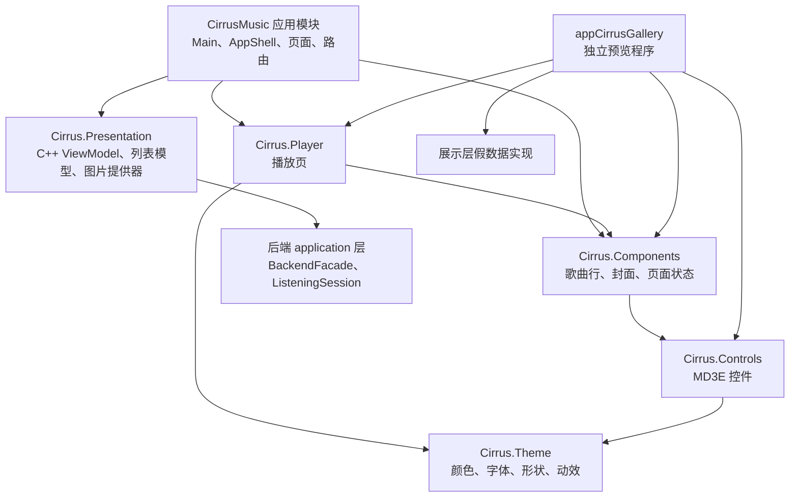

# Cirrus UI 技术方案

> 状态：草案（Draft），待维护者评审。日期：2026-10-17。
>
> 本文是 UI 部分的总体技术方案，回答“UI 用什么风格、怎样分层、按什么顺序做、每一步交付什么”。各阶段开始前会在本目录补充细化文档（见 §13）。本文写到的能力都是计划，不代表已实现。

## 0. 与现有文档的关系

- [07 QML 与设计系统](../07-qml-and-design-system.md) 是早期提案。其中关于视觉风格、控件路线和实施顺序的内容由本文替代；两者冲突时以本文为准（待维护者确认后生效）。
- 架构与安全约束继续有效：QML 不接触凭据、Cookie、签名 URL 和协议 DTO；UI 只通过展示层访问后端（见 [03](../03-system-architecture.md)、[11](../11-security-privacy-and-compliance.md)）。
- 后端对外入口是 `BackendRuntime` 提供的 `facade()`、`listening()`、`fm()`、`resourceQueries()`、`resourceCache()`，契约见 [后台生命周期](../api/backend-runtime.md) 和 [HANDOFF](../HANDOFF.md)。UI 不修改这些契约；需要后端补能力时单独提出。

## 1. 目标与非目标

**目标**

- 跨平台桌面客户端：Linux 优先适配和验证，Windows、macOS 保持可构建、可运行，在有设备后逐项验证。
- 外壳与常规页面采用 **Material 3 Expressive（MD3E）** 风格；**播放页**采用接近 Apple Music 的沉浸式风格；两者属于同一套产品语言，不割裂。
- 基于 Qt 6.11.2（当前已验证 Kit），C++20 + Qt Quick。
- 先用假数据做出可运行的原型并定型，再接入真实业务接口。

**非目标**

- 不复刻 Google 或 Apple 的官方素材：不使用 SF Symbols、SF Pro、Apple 图标或界面截图素材。
- 不使用 Qt 自带的 Material 样式作为成品（它没有 MD3E 的形状、动效和组件）。
- 不引入 WebEngine、Electron 或第三方整套 UI 框架。

## 2. 设计语言

### 2.1 两种语言的分工

| | 外壳与常规页面 | 播放页 |
| --- | --- | --- |
| 风格 | MD3E | 接近 Apple Music |
| 适用范围 | 导航、首页/发现、搜索、音乐库、详情页、设置、登录、迷你播放条、对话框、菜单 | 全屏播放页：封面、歌曲信息、播放控制、进度、音量、歌词、队列面板 |
| 颜色 | MD3 色调方案（surface 容器层级、primary/secondary/tertiary） | 封面取色生成的流动模糊背景，前景以白色系为主 |
| 控件 | 带容器的按钮、色调层级、形状变形 | 无容器的图标按钮、细进度条、大字号歌词 |
| 信息密度 | 中到高 | 低，内容（封面、歌词）优先 |

### 2.2 统一手段

两种风格共享以下五项，用来保证切换时不割裂：

1. **同一个颜色来源。** 当前封面经同一套取色算法得到种子色和若干主色：外壳用种子色生成 MD3 配色方案，播放页用主色生成背景。退出播放页时外壳与背景属于同一色系。
2. **同一套字体。** 全局一个可变字体家族；播放页只是使用更大字号、更粗字重。
3. **同一套图标。** Material Symbols Rounded。外壳用常规粗细；播放页用填充、加粗、不带容器的版本。
4. **同一套动效参数。** 两边使用同一组弹簧参数（§4.4）。
5. **连续的过渡。** 迷你播放条与播放页之间用共享元素过渡：封面从迷你条位置放大到播放页位置，背景从迷你条颜色铺开。不出现硬切。

### 2.3 播放页内部的边界规则

- 队列、歌词、音量、输出设备、歌词翻译开关属于播放页语言。
- 右键菜单、确认对话框、提示条使用 MD3E 组件，但套用由当前封面派生的深色配色。
- 跳转到歌手、专辑、评论等页面时先退出播放页，回到外壳再导航，不在播放页里嵌入外壳页面。
- MD3E 的异形形状（花瓣、饼干等）只用于外壳；播放页封面使用圆角刻度中的一个克制值。

## 3. 总体架构

### 3.1 分层



- **Cirrus.Theme**：主题单例和取色、配色、弹簧计算的 C++ 实现。不依赖任何业务。
- **Cirrus.Controls**：MD3E 控件。只知道主题，不知道歌曲、账号或 API。
- **Cirrus.Components**：业务展示组件，接收展示数据、发出用户意图。
- **Cirrus.Player**：播放页及其专用组件（背景、歌词视图、播放控制）。不依赖 MD3E 控件，只依赖主题和少量通用组件。
- **Cirrus.Presentation**：C++ 展示层，QML 唯一能看到的数据来源。把后端的异步请求、请求 ID、会话 token 过滤、分页、取消，转换成 QML 可绑定的属性、模型和状态。
- **CirrusMusic**：应用模块，组装页面、导航和窗口。

### 3.2 展示层的接口与假实现

为了避免“先按假数据写页面，接入时返工”，展示层从阶段 3 开始就按最终形态设计：

- 每个 ViewModel 是具体的 QObject 类，对 QML 暴露属性、列表模型和 `Q_INVOKABLE` 意图方法。
- ViewModel 的数据来源是注入的 C++ 接口（如 `SongListSource`）。阶段 3、4 注入假实现（本地示例数据、可模拟延迟和失败）；阶段 5 注入包装 `BackendFacade` 的真实实现。QML 代码不需要改动。
- 所有加载型 ViewModel 使用统一的请求状态：`Idle`、`Loading`、`Ready`、`Empty`、`Error`、`Offline`、`SignedOut`、`Partial`。页面必须为每种状态设计展示。
- QML 只拿到展示用的值和不透明 key（如路由参数、封面 key）；歌曲 ID 等以字符串保存，不做数值运算。
- 真实实现必须遵守后端规则：按请求 ID 和会话 token 丢弃过期结果；离开页面或发起新查询时取消旧请求；换号时清空私有数据。

### 3.3 目录与构建（阶段 0 已确认）

```text
ui/
  CMakeLists.txt  所有 UI 模块输出到 build/<preset>/qml/，便于 qmllint 解析导入
  theme/          Cirrus.Theme：fonts.{h,cpp}（文字用系统字体、注册图标字体）、Symbols.qml（图标码位，生成）
    fonts/        图标字体子集、许可文件、symbols.txt（图标清单）
  controls/       Cirrus.Controls：Icon.qml（阶段 2 起补控件）
  samples/        Cirrus.Samples：虚构示例封面、目录、歌词（生成），只供 Gallery 和假数据实现
  app/            CirrusMusic：main.cpp、Main.qml（目前仍是 Qt 模板）
  gallery/        appCirrusGallery：Gallery.qml、pages/
  （阶段 1 起按需新增 components/、player/、presentation/）
tools/ui/
  prepare_fonts.py      获取固定版本字体、校验 SHA-256、裁剪图标、生成 Symbols.qml
  generate_samples.py   生成示例封面、目录、歌词与 Samples.qml
third_party/
  material-color-utilities/   阶段 1 引入（§4.1）
```

- 每个 QML 模块是一个静态库加 `qt_add_qml_module`；可执行程序链接 `<target>plugin` 并在 `main.cpp` 中 `Q_IMPORT_QML_PLUGIN`。QML 单例需在 CMake 中设置 `QT_QML_SINGLETON_TYPE`。
- 模块在第一次有实际内容时才创建，不建空模块。
- `appCirrusMusic` 与 `appCirrusGallery` 都输出到 `build/<preset>/` 根目录。
- Gallery 由 `CIRRUS_BUILD_GALLERY`（默认开启）控制，不打进发行包。`--grab <文件> [--page 名称] [--size WxH]` 渲染一页并保存截图后退出，可在 `QT_QPA_PLATFORM=offscreen` 下使用。
- 后端库不链接任何 UI 模块；只有 `Cirrus.Presentation` 链接 `cirrus_backend`／`cirrus_application`。
- 生成文件（`Symbols.qml`、`Samples.qml`、字体子集、示例数据）不要手工修改，改生成脚本或其输入后重新运行。

## 4. 主题系统（阶段 1）

### 4.1 颜色

**算法库**：Google 的 [material-color-utilities](https://github.com/material-foundation/material-color-utilities)（Apache-2.0），使用其 C++ 实现：图片量化（Celebi = Wu + WSMeans）、颜色评分、HCT 色彩空间、色调色板和动态配色方案。

阶段 1 需要先处理两个已确认的问题：

1. **依赖 Abseil。** `cpp/quantize/wsmeans.cc` 引用了 `absl/container/flat_hash_map.h`。方案：固定提交后只引入需要的子目录，把这处替换为 `std::unordered_map`，并在 `third_party/material-color-utilities/` 中记录修改和 NOTICE；不为此引入整个 Abseil。
2. **C++ 版本落后。** C++ 的 `DynamicScheme` 没有 TS/Java 版本中的 `SpecVersion`、`Platform` 参数，可能未包含 2025 版（MD3E）配色规则。方案：先用 C++ 版本出原型，对照 TS/Java 版本的输出比较差异；差异明显时，参照 TS/Java 补齐所需的方案变体。

**取色流程**

```text
封面（解码后缩到约 128px）
  → 量化（最多 128 色）→ 评分 → 种子色 + 前几位主色
  → 生成亮色、暗色两套 MD3 配色方案
  → 结果按封面 key 缓存
  → 主题单例以颜色动画过渡到新方案
```

- 取色在后台线程执行（`QThreadPool`），每次请求带递增编号，晚到的旧结果直接丢弃。
- 种子色来源三选一：跟随当前封面、固定颜色、跟随系统强调色。默认值待定（UQ-01）。系统强调色在各平台的可读性需验证。
- 亮色/暗色/跟随系统三种模式；跟随系统时监听 `Application.styleHints.colorScheme`。
- 方案变体（TonalSpot、Expressive、Vibrant 等）在原型中比较后确定默认值（UQ-04）。
- 播放页使用同一次取色结果中的主色生成背景，另行计算保证白色文字可读的遮罩强度；对比度按背景最差区域检验。

**主题单例暴露的颜色**：完整的 MD3 角色（primary、onPrimary、primaryContainer……surfaceContainerLowest 至 Highest、outline、inverse、fixed 系列、error 系列）。业务 QML 不直接写颜色值。

### 4.2 字体

- MD3 字体层级：15 个基础样式 + 15 个强调样式（Display、Headline、Title、Body、Label 各大中小）。
- **当前决定：文字使用系统 UI 字体，不随包附带文字字体（UQ-03）。** 中文和其他文字由系统自行回退（Linux 常见 Noto Sans CJK，Windows 微软雅黑，macOS 苹方）。代价是各平台观感不同，也不能依赖字宽、圆度等可变轴，字体层级只用字号、字重、行高和字距表达。
- 唯一的修改点是 `ui/theme/fonts.cpp` 的 `textFamily()`；QML 统一使用 `Fonts.sans`，以后改为随包字体时页面不用改。候选字体（Google Sans Flex、Noto Sans SC）的来源与限制记录在 `ui/theme/fonts/README.md`。
- 中西文混排时检查基线和行高；播放页歌词以中文为主，字体选择要以中文效果优先。

### 4.3 形状、状态层与高度

- **圆角刻度**：none、extra-small、small、medium、large、large-increased、extra-large、extra-large-increased、extra-extra-large、full，具体数值在阶段 1 按 MD3 官方规范核对后写入主题。
- **形状变形**：MD3E 的标志特性（按钮按下变形、加载指示器在多种形状间变换）。候选方案 [m3shapes](https://github.com/soramanew/m3shapes)（Apache-2.0，androidx graphics-shapes 的 Qt QML 移植，Caelestia 在用）。它是较新的项目（AUR 包首次提交于 2026-07），阶段 1 评估其成熟度和渲染开销，再决定直接依赖还是自行移植。
- **状态层**：悬停 8%、焦点 10%、按下 10%、拖动 16% 的前景色叠加，统一由控件基础组件实现。
- **高度**：以色调层级为主，阴影只用在少数浮层（菜单、对话框、迷你播放条）。

### 4.4 动效

**参数**：采用 MD3 动效体系的弹簧参数（阻尼比／刚度），分“空间”（位置、尺寸、缩放，可以回弹）和“效果”（颜色、透明度，不回弹）两类。下表数值来自 androidx Compose material3 的 `MotionScheme` 实现：

| 档位 | 空间：标准 | 空间：Expressive | 效果（两种方案相同） |
| --- | --- | --- | --- |
| 快 | 0.9 / 1400 | 0.6 / 800 | 1.0 / 3800 |
| 默认 | 0.9 / 700 | 0.8 / 380 | 1.0 / 1600 |
| 慢 | 0.9 / 300 | 0.8 / 200 | 1.0 / 800 |

- 小部件（开关、图标）用快档；全屏过渡用慢档；其余用默认档。
- 外壳的标志性动作用 Expressive 空间弹簧，列表、导航等日常动作可用标准空间弹簧，在原型中确认。
- 播放页使用同一张表。

**在 Qt 中的实现**：Qt 的 `SpringAnimation` 参数是 `spring`（0–5）、`damping`、`mass`，语义与“刚度 + 阻尼比”不同，没有直接换算关系。阶段 1 先做实验：

1. 尝试用 `SpringAnimation` 拟合上表曲线，检查曲线形状以及被打断时速度是否连续。它的好处是可以直接用在 `Behavior` 里。
2. 拟合不了时，用 C++ 实现一个弹簧值类型（基于公开 API `QAbstractAnimation`，按解析解逐帧计算，重新设定目标时保留当前速度），对 QML 暴露 `value`、`target`、`stiffness`、`dampingRatio`。代价是不能写在 `Behavior` 里，需要用绑定 `x: spring.value` 的方式使用。

实验结果写入阶段 1 的细化文档。

**减少动态效果**：全局开关。开启后空间动画改为短时淡入淡出，播放页背景静止，歌词不做逐字弹跳和模糊动画。各平台系统设置的读取方式待验证，至少提供应用内开关。

### 4.5 主题 API（草图）

```qml
// 用法示意，最终命名在阶段 1 确定
Rectangle {
    color: Theme.color.surfaceContainer
    radius: Theme.shape.large
}
Text {
    font: Theme.type.titleMedium
    color: Theme.color.onSurface
}
```

## 5. MD3E 控件（阶段 2）

- 控件基于 `QtQuick.Templates` 编写，只重画外观，保留 Qt 的键盘、焦点、输入法、无障碍等行为。不用 Rectangle + MouseArea 拼按钮。
- 不注册全局 QQuickStyle；业务代码只导入 `Cirrus.Controls`，不同时导入 `QtQuick.Controls`，以避免同名类型冲突。控件是否加前缀在阶段 2 开始前确定。
- 每个控件从第一版起就具备：全部交互状态、键盘操作、可见焦点、读屏名称（`Accessible.name`）、`qsTr` 文案、减少动态效果下的表现。
- 每个控件在 Gallery 中有独立页面，展示所有状态和亮暗两套主题。

**第一批（核心）**：Button（filled、tonal、outlined、text、elevated，含 MD3E 尺寸档）、IconButton、ToggleButton 和按钮组、Switch、Checkbox、RadioButton、TextField、SearchBar、Slider、线性和环形进度指示器、加载指示器、ListItem、Menu、Tooltip、ScrollBar。

**第二批（按页面需要）**：Dialog、Snackbar、Chips、Tabs、NavigationRail（展开/收起）、Card、Divider、Badge、下拉选择。

## 6. 外壳与页面（阶段 3）

### 6.1 窗口与标题栏（UQ-02）

| 方案 | 做法 | 优点 | 代价 |
| --- | --- | --- | --- |
| A 原生标题栏 | 默认窗口 | 最简单，各平台行为正确 | 标题栏与 MD3E 内容视觉脱节；GNOME Wayland 下由 Qt 绘制客户端装饰，需要随 Qt 部署 qtwayland 的 adwaita 装饰插件才好看 |
| B 扩展客户区 | Qt 6.9 起的 `Qt.ExpandedClientAreaHint` + `Qt.NoTitleBarBackgroundHint`，配合 `SafeArea` 避让系统按钮 | 保留系统按钮和窗口行为，内容延伸到标题栏区域 | 各平台支持程度不同，Linux 上的效果需验证 |
| C 完全自绘 | 无边框窗口，`startSystemMove()`／`startSystemResize()` 处理拖动和缩放 | 三平台外观完全一致 | 需要自己处理缩放边缘、阴影、双击最大化；Windows 贴靠布局和 macOS 红绿灯需要额外处理 |

建议在阶段 3 开始时用最小窗口原型对比三种方案后决定，可以按平台选择不同方案（例如 macOS 用 B）。

### 6.2 布局与响应式

- 按 MD3 窗口尺寸分级：compact（<600）、medium（600–839）、expanded（840–1199）、large（1200–1599）、extra-large（≥1600），桌面端主要处理 medium 及以上，compact 下保证播放、导航、退出可用。
- 主体结构：导航栏（NavigationRail，可展开/收起）+ 内容区 + 可选的辅助面板（如队列）+ 底部常驻迷你播放条。
- 导航：自建页面栈，路由使用类型化参数（如歌单路由带歌单 key），返回时恢复滚动位置；页面缓存设上限，不让所有页面常驻；换号时清除私有页面的历史。

### 6.3 页面清单（第一轮）

首页/发现、每日推荐、私人 FM 入口、搜索（建议、热搜、分类结果）、音乐库（喜欢、歌单、收藏、最近播放）、歌单/专辑/歌手详情、评论、登录（二维码）、设置。

### 6.4 页面状态

每个页面都要设计：首次加载（骨架屏）、刷新、空、错误（带重试）、离线、未登录、部分数据。这些状态做成 `Cirrus.Components` 里的通用组件，阶段 3 随页面一起交付。

### 6.5 参考

布局参考社区现成方案，阶段 0 的参考调研清单逐项给出“借鉴什么、许可是什么、能否借代码”。初步名单：

| 项目 | 许可 | 借鉴内容 | 代码 |
| --- | --- | --- | --- |
| [illogical-impulse（end-4/dots-hyprland）](https://github.com/end-4/dots-hyprland) | GPL-3.0 | MD3 配色运用、密度、动效手感、媒体控件 | 不复制 |
| [Caelestia shell](https://github.com/caelestia-dots/shell) | GPL-3.0 | MD3E 形状与动效、媒体面板 | 不复制 |
| [Noctalia](https://github.com/noctalia-dev/noctalia) | MIT | MD3 配色组织方式 | 已改为不依赖 Qt 的 C++ 实现，代码参考价值低 |
| [YesPlayMusic](https://github.com/qier222/YesPlayMusic) | 主分支 MIT（v2 分支为 AGPL-3.0） | 网易云客户端的信息结构、Apple Music 风格播放页 | 技术栈不同，主要借鉴设计 |
| [AMLL](https://github.com/amll-dev/applemusic-like-lyrics) | AGPL-3.0 | Apple Music 风格逐字歌词效果 | 不复制 |

illogical-impulse 与 Caelestia 基于 Quickshell，本身就是 QML 实现，参考价值高；但它们是桌面外壳而不是应用，应用的信息结构还要参考音乐客户端。项目自身许可证尚未确定，确定前不复制任何 GPL/AGPL 代码。完整清单（含 MD3 音乐客户端与播放页参考）见 [references.md](references.md)。

## 7. 播放页（阶段 4）

### 7.1 结构

- 背景层、封面、歌曲信息、播放控制（上一首、播放/暂停、下一首、播放模式）、进度条、音量、歌词、队列面板。
- 宽窗口：封面与歌词左右分区；窄窗口：封面视图与歌词视图切换。断点在原型中确定。

### 7.2 背景

- 方案 1：放大并高斯模糊的封面（`MultiEffect`），实现简单、开销低。
- 方案 2：用取色得到的主色驱动的流动渐变（自定义 `ShaderEffect`，经 ShaderTools 编译为各图形后端可用的着色器），更接近 Apple Music。
- 两种方案都在降低分辨率的纹理上渲染；暂停播放、窗口最小化或不可见时停止动画；减少动态效果模式下使用静态背景。

### 7.3 歌词视图

- 数据来自 `ListeningSession` 的歌词状态和游标（原文、翻译、音译、逐字等六轨）。
- 当前行突出（字号、字重、透明度），其余行按与当前行的距离逐渐淡化；模糊只作用于可见范围内少量行，并能整体关闭。
- 逐字高亮：用文字裁剪或渐变遮罩实现填充推进，逐字时间不可用时降级为逐行。
- 用户手动滚动后进入浏览模式，暂停自动跟随，提供“回到当前行”；点击某行在可跳转时发出跳转意图。
- 无歌词、纯音乐、加载失败、权限不足分别展示，不显示空白。

### 7.4 控制区

- 图标按钮不带容器，按下有缩放反馈。
- 进度条默认细，悬停或拖动时变粗；拖动期间发出“预览位置”，松手后才发出“跳转”，期间不被播放进度拉回。

## 8. 过渡编排

以下跨组件动画在实现前先写编排说明（时间线、谁先动谁跟随、使用哪档弹簧、被打断时如何处理），放在阶段 3 开始前的细化文档里：

- 迷你播放条 ↔ 播放页：封面共享元素过渡、背景铺开、控件淡入。实现上在外壳之上放一个覆盖层，用 `mapToItem` 交接封面的起止位置和尺寸。Esc 和返回操作可以中途打断并反向。
- 页面切换与返回。
- 切歌时的取色过渡（外壳与播放页同时）。
- 导航栏展开与收起。

## 9. 图片管线

- C++ 异步图片提供器（`QQuickAsyncImageProvider`），QML 使用不透明 key（如 `image://cover/<key>/<尺寸>`），不出现真实 URL。
- 按显示尺寸解码，内存缓存设上限；占位图尺寸稳定，加载失败时页面不跳动。
- 同一次解码结果同时供取色使用，避免重复解码。
- 原型阶段由本地示例封面提供；阶段 5 接入后端的 `ResourceCacheService`／封面获取能力。后端在 `resourceCacheRoot` 为空时关闭封面缓存，接入时需要确定缓存目录（UQ-06）。

## 10. 跨平台

| 事项 | 处理方式 |
| --- | --- |
| 图形后端 | Qt RHI：Linux 为 Vulkan/OpenGL，Windows 为 D3D11，macOS 为 Metal。自定义着色器通过 ShaderTools 生成各后端版本 |
| 字体 | 文字用各平台系统字体（UQ-03），观感差异需分别检查；图标字体随包附带 |
| 标题栏 | 见 §6.1 |
| 快捷键 | 使用 `StandardKey`，自定义快捷键按平台区分 Ctrl 和 Cmd |
| 缩放 | 测试 100%/125%/150%/200%，以及 Wayland 分数缩放 |
| 深浅色与强调色 | 读取系统设置，各平台分别验证 |
| 触控板滚动 | Linux、macOS 惯性滚动的手感分别调校 |
| 托盘、通知、菜单栏 | 阶段 6 处理；macOS 全局菜单栏另行评估 |

当前只有 Linux 设备。每个阶段在 Linux 上验收，Windows、macOS 的验证记录为待办，不宣称已支持。

## 11. 资源与许可

| 资源 | 许可 | 用途 | 状态 |
| --- | --- | --- | --- |
| Material Symbols Rounded | Apache-2.0 | 全局图标（可变字体：填充、字重、等级、光学尺寸） | 候选，阶段 0 确认是否裁剪子集 |
| 文字字体 | — | 文字显示 | 暂用系统字体，不打包（UQ-03）；候选见 `ui/theme/fonts/README.md` |
| material-color-utilities | Apache-2.0 | 取色与配色方案 | 计划引入固定提交（需去除 Abseil 依赖） |
| m3shapes | Apache-2.0 | MD3E 形状与变形 | 待评估 |

所有随包分发的字体和代码在 `third_party/` 或资源目录中保留许可文件，并登记到依赖清单（见 [02](../02-technology-stack.md) 的依赖准入要求）。

## 12. 阶段计划

| 阶段 | 交付内容 | 完成条件 |
| --- | --- | --- |
| 0 工程基础（**已完成**，见 §15） | `ui/` 目录和各 QML 模块的 CMake；Gallery 空壳；字体、图标入库及许可文件；示例封面和示例数据；参考调研清单 | Linux 上 Debug/Release 构建通过，Gallery 能启动，qmllint 无错误 |
| 1 主题系统 | material-color-utilities 引入与改造；后台取色；主题单例（颜色、字体、形状、状态层、动效）；弹簧实验报告；Gallery 主题页（切换封面/种子色/亮暗，查看配色、字体层级、圆角、动效） | 切换封面时配色平滑过渡且不卡顿；文字与背景对比度达标 |
| 2 MD3E 核心控件 | §5 第一批控件及 Gallery 页面 | 每个控件的状态、键盘、焦点、读屏名称在 Gallery 中可检查 |
| 3 外壳与页面 | 先写过渡编排说明和 ViewModel 接口说明；窗口方案对比；导航、响应式、迷你播放条、§6.3 页面及其状态；展示层假实现 | 用假数据走通主要页面和导航，所有页面状态可在 Gallery 或调试开关中触发 |
| 4 播放页 | 背景、封面、控制区、歌词视图、队列面板，以及与迷你条的过渡 | 用示例歌词和模拟播放进度完整运行；减少动态效果模式正常 |
| 5 业务接入 | 展示层真实实现、封面图片提供器、`main.cpp` 组装 `BackendRuntime`；按功能逐个接入：启动与登录 → 搜索 → 歌单/专辑详情 → 播放、队列与歌词 → 音乐库 → 发现 → 评论等 | 每个功能接入后在真实后端下走通，加载、错误、取消、换号行为正确 |
| 6 打磨 | 动效一致性、性能（长列表、模糊开销）、无障碍、三平台验证、托盘/通知/快捷键 | 待阶段 5 结束时细化 |

阶段 4 只依赖阶段 1，可以与阶段 2、3 并行。

## 13. 细化文档计划

| 文档 | 编写时机 |
| --- | --- |
| [`docs/ui/references.md`](references.md) 参考调研清单 | 阶段 0（已完成） |
| `docs/ui/theme.md` 主题系统与弹簧实验结果 | 阶段 1 |
| `docs/ui/controls.md` 控件清单与各控件规格 | 阶段 2 |
| `docs/ui/motion-choreography.md` 过渡编排说明 | 阶段 3 开始前 |
| `docs/ui/presentation.md` ViewModel 与模型接口 | 阶段 3 开始前 |
| `docs/ui/player.md` 播放页规格 | 阶段 4 开始前 |

## 14. 待决问题

| 编号 | 问题 | 当前倾向 | 需要在何时决定 |
| --- | --- | --- | --- |
| UQ-01 | 外壳种子色默认来源：跟随封面、固定、跟随系统 | 提供三种选项，默认值看原型效果 | 阶段 1 结束 |
| UQ-02 | 窗口标题栏方案（§6.1） | 原型对比后决定，可按平台区分 | 阶段 3 开始 |
| UQ-03 | 文字字体：系统字体还是随包附带 | **暂定使用系统字体，不打包**；以后可能改为随包，也可能一直不打包。修改点见 §4.2 | 维护者以后决定 |
| UQ-04 | 默认配色方案变体 | 原型比较 TonalSpot 与 Expressive | 阶段 1 |
| UQ-05 | 播放页在亮色主题下是否仍使用深色背景、浅色文字 | 倾向始终深色，与 Apple Music 一致 | 阶段 4 开始 |
| UQ-06 | 应用身份（app ID）、配置与缓存目录 | 原型阶段用开发占位值 | 阶段 5 开始 |
| UQ-07 | UI 是否编写 Qt Quick Test 自动化测试 | 至少以 Gallery 做人工检查，自动化测试范围待定 | 阶段 2 开始 |
| UQ-08 | m3shapes 直接依赖还是自行移植 | 阶段 1 评估后决定 | 阶段 2 开始 |

## 15. 实施记录

### 阶段 0：工程基础（2026-10-17）

**交付**

- `ui/` 目录与 `Cirrus.Theme`、`Cirrus.Controls`、`Cirrus.Samples`、`CirrusMusic`、`CirrusGallery` 五个 QML 模块，结构见 §3.3；原根目录的 `main.cpp`、`Main.qml` 已迁入 `ui/app/`，可执行文件位置不变。
- 随包字体：Material Symbols Rounded 2.973 的 96 个图标子集（171 KB，保留全部可变轴），来源、SHA-256 与修改说明见 `ui/theme/fonts/README.md`。文字使用系统字体（最初引入的 Google Sans Flex 已按维护者意见撤出）。
- 虚构示例数据：12 张程序绘制的封面、13 张专辑／38 首歌曲／5 个歌单、2 份带翻译与逐字时间的歌词，说明见 `ui/samples/README.md`。
- Gallery 资源页：系统字体的字重 Thin–Black，中文／日文／希腊／西里尔／emoji 混排，全部图标（可调填充、字重、尺寸），全部示例封面。
- [参考调研清单](references.md)。

**验证（Linux，Qt 6.11.2）**

- Debug、Release 下 `appCirrusMusic`、`appCirrusGallery`、`cirrus_backend` 构建无警告；`all_qmllint` 无警告。
- `QT_QPA_PLATFORM=offscreen` 下 Gallery 截图检查：系统字体与中文（Noto Sans CJK SC）按 `font.weight` 选取相近字重；日文、希腊、西里尔、emoji 正常回退；图标填充和字重轴生效。离屏模式没有桌面平台主题，系统字体显示为通用名 `Sans Serif`，真实桌面会话中取 GNOME/KDE 设置的字体。`appCirrusMusic` 离屏启动正常（仍是模板窗口）。
- 新增 C++ 文件通过 clang-format 检查。
- 未在 Windows、macOS 上构建或运行。

**发现的问题**

- 全量构建中后端测试 `tests/unit/entity_search_test.cpp:42` 编译失败：`detail::aes` 同时匹配 `cirrus::netease::detail` 与 `backend_facade.h` 中的 `cirrus::application::detail`。该问题来自后端提交 `2c164a7`（评论写入 Facade 拆分）引入的 `namespace detail`，与 UI 改动无关，UI 侧未修改后端代码。其余目标全部构建通过。
- Google Sans Flex 4.005 只覆盖 535 个拉丁字符，商标说明限制修改版使用其名称；已不打包，记录保留在 `ui/theme/fonts/README.md`。
- QML 中 `onXxx` 形式的名字与信号处理器冲突，MD3 颜色角色名需在阶段 1 规避，详见 [references.md §6](references.md)。
